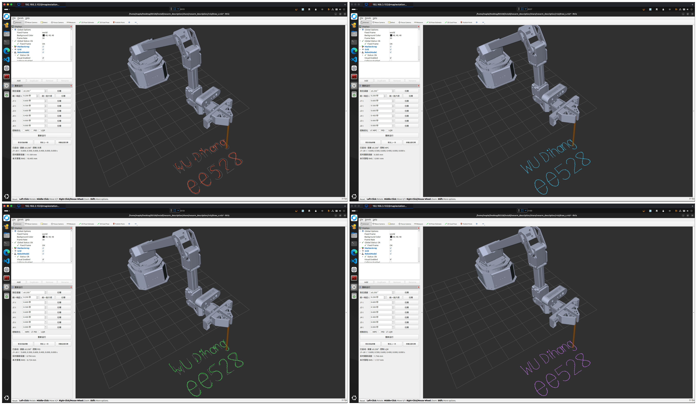
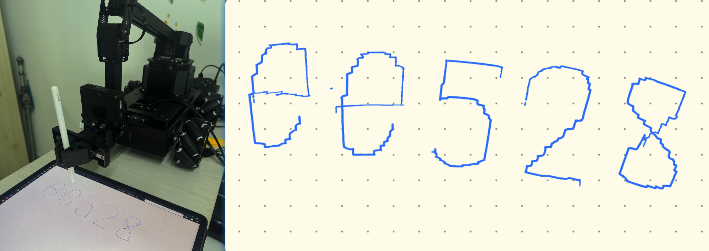
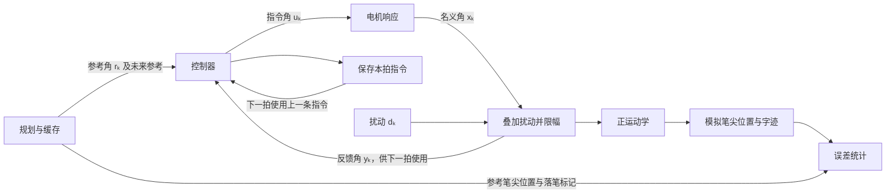
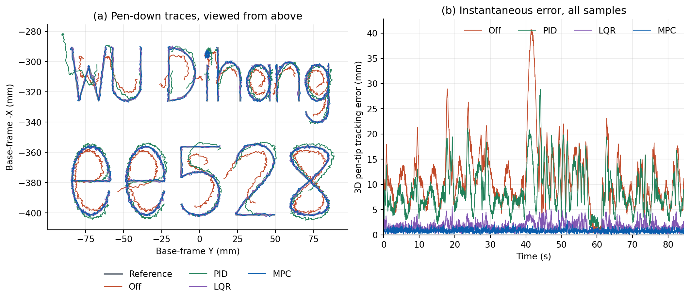

## 机械臂书写轨迹的闭环跟踪与优化

姓名 WU Dihang · 学号 26040407g · 课程选题 A—Optimal Control

* 机械臂写字时，各关节舵机对指令的响应速度不同，笔尖会落后，转角时也容易变形。

* 本项目使用 ros2 和 rviz，通过人为设置不同关节的响应延迟，以及随机舵机精度误差，来模拟真实的机械臂运行场景，分别用MPC，LQR，PID 来实现轨迹优化，并与无优化模式(Off模式)一起，一共四个模式进行对比评估。
    
    
    *图 1　四种优化模式：左上角无优化(off)，右上角MPC，左下角PID，右下角LQR*
    
* 本项目的仿真机械臂与实际物理机械臂完全相同，并且用实际机械臂完成了文字的书写。但是因为舵机精度有限，没有优化的意义，因此只在无优化模式下使用 iPad 和 Apple Pencil 验证了笔迹`ee528`的正确性。
  
  
  *图 2　真实机械臂书写效果*
  
  

## 1. 项目目标与整体方案

### 1.1 书写任务与控制问题

机械臂握笔，在水平面上写出课程代号 `ee528` 和姓名 `WU Dihang`。即使给定的笔画完全正确，电机也需要时间转到目标角度。例如，写到 `2` 的底部时，笔尖应该从斜线转为横线。如果几个关节跟进的快慢不同，这个转角就会变形。项目比较四种发令方式，观察哪一种能让笔尖按时到达目标，同时尽可能地保留字形。

四种模式分别是直接发送参考角度（Off）、Proportional–Integral–Derivative (PID）、Linear Quadratic Regulator (LQR）和 Model Predictive Control (MPC)。每次运行只选一种。比较时固定轨迹、起点和扰动，看误差比 Off 降低了多少，并检查指令是否符合关节角度和速度限制。项目按相对改善评价效果，没有预设必须达到的毫米数。

### 1.2 系统输入输出及闭环框图

**规划时**，程序沿笔画逐点计算每个关节应该转到的角度，使笔尖能够到达预定位置。这个计划角度称为**参考角**，也叫**目标角**。

**仿真时**，Off 模式直接把参考角作为指令发给电机模型。PID、LQR 和 MPC 则利用本拍的参考角和上一拍的反馈角计算指令，其中 MPC 还会提前查看后续的参考角。电机模型收到指令后，算出这一拍各关节转到的角度，这就是新的**反馈角**。程序再根据这些反馈角算出笔尖位置，将每一笔的落笔点依次连起来，得到模拟字迹，并与参考笔画比较。

| 符号 | 在本报告中的含义 |
|---|---|
| $j$、$k$、$T_s$ | $j$ 是关节编号，J1～J6 表示第 1～6 个关节（J 来自 Joint）。$k$ 是采样序号，$k-1$ 是上一拍。$T_s$ 是两拍之间的时间，下标 $s$ 表示采样。 |
| $r_{j,k}$、$u_{j,k}$ | 第 $j$ 个关节在第 $k$ 拍的参考角和实际发送的指令角。 |
| $x_{j,k}$、$d_{j,k}$、$y_{j,k}$ | 电机模型算出的名义角、加到该角度上的扰动，以及限幅后送回控制器的模拟反馈角。 |

*图 3　系统输入输出及闭环示意图*

### 1.3 Python／ROS 2／RViz、MATLAB 与实机的分工

Python 生成参考轨迹，计算控制指令和电机响应。ROS 2 传递关节角和笔迹数据；RViz显示机械臂动作；MATLAB用相同输入独立运行四种模式，便于画图和核对数值；实体机械臂用于无优化书写，检查规划出的关节动作能否带动画笔完成笔画。

模型把笔固定在夹爪上，用 J1～J5 的位置算出笔尖坐标，J6 只控制夹爪开合。六路舵机各自响应，时间常数采用仿真设定。纸面设为水平面，落笔状态取自规划。即使反馈算出的笔尖略高于或低于纸面，程序也保留这个高度偏差。关节之间的动力影响、机构弹性、摩擦和笔尖接触力均未考虑。

## 2. 参考书写轨迹的生成

### 2.1 ee528 和 WU Dihang 的字形定义

规划器先把 `ee528` 和 `WU Dihang` 拆成有顺序的笔画。直笔用线段，弯笔用圆弧或三次贝塞尔曲线。例如，`e` 从中间的横线起笔，再绕出一个开口的圈；`2` 和 `5` 的弯钩用贝塞尔曲线连接，起点和终点决定曲线两端，另外两个控制点决定弯曲方向。`8` 用一条连续曲线绕完上下两圈，经过中间交叉点时保持落笔。字形定义见 `nexarm_description/nexarm_description/draw_s.py` 中的 `text_strokes()`。

### 2.2 坐标映射、落笔与抬笔规划

`writing_targets()` 把平面笔画排成三维运动段。笔尖沿底座坐标系的 $X$、$Y$ 方向写字，沿 $Z$ 方向抬笔。姓名行按字母宽度和间距排好，再缩放到与 `ee528` 相同的宽度。两行分别绕自身中心旋转 180°，从底座后方看，文字方向就是正的。

书写平面比底座坐标系 `base_link` 的原点低 0.10 m，对应世界坐标系 `world` 的地面。换笔时，笔尖先竖直抬高 15 mm，再平移到下一笔起点并落下。每段都有落笔标记，所以空中移动会计入机械臂运动，但不会把两笔连起来。

### 2.3 时间采样与逆运动学

程序以 30 Hz（每秒 30 次）安排笔尖位置，长线段分到更多采样点，每段至少 3 点，并在两端平滑起停。默认的 50 s 用来分配采样点；加上每段的最少点数和向上取整，整条轨迹实际约为 84.47 s。

已知某一拍笔尖要到哪里，下一步是算各关节应该转多少，这就是**逆运动学**。设 $k$ 为采样序号，$\mathbf p_k^*$ 为该拍的目标笔尖坐标，星号表示目标值。$\mathbf q=(q_1,q_2,q_3,q_4)$ 是 J1～J4 待求的角度。笔尖固定在夹爪局部坐标的前方 0.04 m、下方 0.125 m。程序根据连杆几何和这段固定偏移，从 $\mathbf q$ 算出笔尖坐标 $\mathbf p_{\rm tip}(\mathbf q)$（tip 表示笔尖）。在关节角度允许的范围内，选择使下式最小的 $\mathbf q$：

$$
\left\|\mathbf p_{\rm tip}(\mathbf q)-\mathbf p_k^*\right\|_2^2
+\left[0.1(q_2+q_3+q_4)\right]^2 .
$$

第一项是笔尖到目标的直线距离平方，$\|\cdot\|_2$ 表示向量长度。第二项让三个俯仰角的和接近零，使笔保持近似竖直；0.1（米/弧度）是姿态项的权重。求下一个点时沿用上一拍的角度作初值。`plan()` 检查笔尖位置误差及含姿态项的总残差，两者都要在 0.5 mm 以内。相邻点所需的关节速度也不能超过 3.14 rad/s（弧度每秒）。J5 的参考角固定为零，J6 保持夹笔角度。最后将求得的角度代回正运动学，得到可达的参考笔尖位置。

### 2.4 两个平台共用参考轨迹的方法

ROS 2 启动时调用 Python 规划器生成参考轨迹。MATLAB 读取同一个规划器预先导出的 `matlab/data/reference.mat`。其中保存了六个关节的参考角、参考笔尖坐标、采样时间和落笔标记，两边因此可以在同一时刻、同一笔画上比较结果。默认双行轨迹共有 **2,535 个采样点**，其中 **1,835 个是落笔点**，分属 **18 个连续落笔区段**。

修改字形、抬笔高度或书写时长后，需要用 `matlab/tools/export_reference.py` 重新导出数据。该脚本还生成 `matlab/data/python_baseline.mat`，供测试程序核对 MATLAB 与 Python 各自算出的结果。数据的采样参数和源文件版本记在 `matlab/data/metadata.json`。仓库里的 `trajectories/ee528.csv` 是早期的 1,722 点轨迹，本次双行实验以 `reference.mat` 为准。

## 3. 被控对象建模与控制器设计

### 3.1 电机一阶响应模型与随机扰动

考察一个关节。设 $t$ 为连续时间，$u$ 为一拍内保持不变的指令角，$x(t)$ 为名义角，$\tau$（希腊字母 tau）为电机时间常数，单位为 s。一阶模型假设转动速度与剩余角差成正比。记 $t_0$ 为这一拍的起点，则

$$
\frac{dx}{dt}=\frac{u-x}{\tau}
\quad\Longrightarrow\quad
x(t_0+T_s)-u=[x(t_0)-u]\exp(-T_s/\tau).
$$

$dx/dt$ 表示角度随时间的变化率，$\exp$ 是自然指数函数。右式说明每过一拍，剩余角差都会乘以同一个比例。令 $a=\exp(-T_s/\tau)$ 为保留的比例，$b=1-a$ 为补上的比例，就得到代码每拍使用的更新式（限幅前）

$$
x_k=a x_{k-1}+b u_k .
$$

J1～J4 的 $\tau$ 分别为 0.6、0.5、0.6、0.4 s。例如 J2 每拍补上 $1-\exp[-(1/30)/0.5]\approx6.45\%$ 的剩余角差。若还差 10°，这一拍约转 0.645°。J5、J6 设为即时响应，直接取 $a=0$、$b=1$。

为模拟到位偏差，令 $w_k$ 为本拍新抽取的随机角度，在 ±0.2° 内均匀取值。令 $\rho=0.35$ 为上一拍扰动保留的比例，则 $d_k=\rho d_{k-1}+(1-\rho)w_k$。各关节的初始扰动为零，J1～J5 独立抽样，J6 保持零扰动。程序先把名义角限制在关节范围内，再将 $x_k+d_k$ 限制在同一范围内作为反馈角 $y_k$。

六个关节的角度按 J1～J6 排成列向量，便能一次写出六路电机的更新式。$\mathbf A$ 的对角线放六个 $a_j$，$\mathbf B$ 的对角线放六个 $b_j=1-a_j$，其他元素为零。两个矩阵都是 $6\times6$。令 $\underline{\mathbf q}$、$\overline{\mathbf q}$ 为六个关节各自的下限、上限，$\operatorname{clip}$ 表示把越界值截到最近的边界，实际更新为

$$
\begin{aligned}
\mathbf x_k&=\operatorname{clip}(\mathbf A\mathbf x_{k-1}+\mathbf B\mathbf u_k,
                                 \underline{\mathbf q},\overline{\mathbf q}),\\
\mathbf y_k&=\operatorname{clip}(\mathbf x_k+\mathbf d_k,
                                 \underline{\mathbf q},\overline{\mathbf q}).
\end{aligned}
$$

这里的粗体 $\mathbf x_k,\mathbf u_k,\mathbf d_k,\mathbf y_k$ 分别把六个名义角、指令角、扰动和反馈角放在一起。下表列出模型用到的角度范围。Xacro（XML Macros）用宏来组织机器人模型文件。XML（Extensible Markup Language，可扩展标记语言）用标签描述数据。Xacro 模型在运行时展开成 URDF。机械臂模型（`nexarm_description/urdf/nexarm.urdf.xacro`） · Python 电机模型（`algorithm/mpc/nexarm_mpc/simulation.py`） · MATLAB 电机模型（`matlab/+nexarm/+model/MotorModel.m`）

| 角度限制（rad） | J1 | J2 | J3 | J4 | J5 | J6 |
|---|---:|---:|---:|---:|---:|---:|
| 下限 | −2.09 | −1.57 | −3.14 | −0.66 | −2.09 | 0 |
| 上限 | 2.09 | 1.40 | 0.30 | 1.57 | 2.09 | 0.50 |

### 3.2 闭环反馈时序与关节约束

控制器在第 $k$ 拍能用的是目标 $r_k$、上一拍反馈 $y_{k-1}$ 和上一条指令 $u_{k-1}$。它发出 $u_k$ 后，电机才产生本拍反馈 $y_k$。记 $\Delta$ 为相邻两拍之差，$q_{\min},q_{\max}$ 为该关节的角度下、上限，$v_{\max}$ 为速度上限（min、max 表示最小、最大）。每拍允许的最大指令变化量 $\delta$ 由速度换算而来。

$$
\Delta u_k=u_k-u_{k-1},\qquad \delta=v_{\max}T_s,\qquad
q_{\min}\le u_k\le q_{\max},\quad |\Delta u_k|\le\delta .
$$

竖线表示绝对值。本项目取 $v_{\max}=3.14$ rad/s（弧度每秒），因此 $\delta\approx0.1047$ rad，约为 6°。下文的比例积分微分控制和线性二次型调节器都按这两条限制裁剪指令。模型预测控制还在预测中检查未来关节角和速度。

### 3.3 Off：直接发送参考指令

Off 是关闭外层补偿的模式。控制律只有 $u_k=r_k$，即原样发送参考角。即使反馈显示关节落后，下一拍仍发原定目标。电机的滞后和扰动照常生效，得到四组对比的基线。

### 3.4 PID 控制

PID 来自 Proportional、Integral、Derivative，即比例、积分和微分。先算当前需要修正的角差 $e_k=r_k-y_{k-1}$。把偏差乘以采样时间并累加，得到候选积分 $I_k^*$（星号在这里表示候选值）。把相邻偏差之差除以采样时间，得到变化率，再按下式平滑，得到微分项 $D_k$。

$$
I_k^*=I_{k-1}+T_s e_k,\qquad
D_k=0.8D_{k-1}+0.2\,\frac{e_k-e_{k-1}}{T_s}.
$$

$I_{k-1}$ 是上拍已接受的累计偏差（rad·s），$D_{k-1}$ 是上拍的平滑变化率（rad/s）。首拍的微分项设为零。以目标角为起点，加上三项修正，得到限幅前的指令 $u_k^{\rm raw}$（raw 表示原始值）。

$$
u_k^{\rm raw}=r_k+K_p e_k+K_i I_k^*+K_d D_k .
$$

$K_p=0.6$ 是比例增益，决定当下纠偏多少。$K_i=0.5$ s⁻¹ 是积分增益，补偿持续积累的偏差。$K_d=0.01$ s 是微分增益，响应偏差的变化。程序把原始指令限幅为 $u_k$。如果指令已经碰到上限而偏差还要求继续加大指令，就保留旧积分，避免越积越多。下限同理。

代码用 $(u_k^{\rm raw}-u_k)e_k>0$ 判断积分是否会把指令进一步推向边界。条件成立时沿用 $I_{k-1}$，否则保存候选积分 $I_k^*$。PID 和 LQR 都同时检查关节行程和单步变化量。把两组限制取交集后，实际允许发送的范围为

$$
\max(q_{\min},u_{k-1}-\delta)\ \le u_k\le\
\min(q_{\max},u_{k-1}+\delta).
$$

若 $u_k^{\rm raw}$ 落在范围外，就发送离它最近的边界值。Python PID 实现（`algorithm/pid/nexarm_pid/controller.py`） · MATLAB PID 实现（`matlab/algorithm/PIDController.m`）

### 3.5 LQR 控制

LQR（Linear Quadratic Regulator，线性二次型调节器）用电机模型算出每个关节的纠偏系数。先考虑目标角固定为 $r$ 的情况。记 $\xi=x-r$ 为名义角偏差，$\nu=u-r$ 为指令相对目标的补偿量。由 $a+b=1$，把两者代入 3.1 的更新式，得到下一拍的偏差 $\xi^+=a\xi+b\nu$，上标 $+$ 表示下一拍。

给角度偏差和补偿量的平方分别加权，单步代价为 $Q\xi^2+R\nu^2$。$Q=20$ 是跟踪误差权重，$R=0.2$ 是控制补偿权重。若从当前偏差出发的最小长期代价写成 $P\xi^2$，$P$ 就是描述未来代价的系数。“本拍代价加下一拍的最小代价”应满足

$$
P\xi^2=\min_{\nu}\left[Q\xi^2+R\nu^2+P(a\xi+b\nu)^2\right].
$$

$\min_{\nu}$ 表示挑选使括号内数值最小的补偿量。对 $\nu$ 求导并令导数为零，可得 $(R+b^2P)\nu+abP\xi=0$。所以最优补偿为 $\nu=-K\xi$，其中 $K$ 是反馈增益。将最优补偿代回上式，整理后可同时确定 $P$ 和 $K$。

$$
P=Q+a^2P-\frac{(abP)^2}{R+b^2P},\qquad
K=\frac{abP}{R+b^2P}.
$$

程序在开始书写前为每个关节算好 $K$。运行时将当前目标 $r_k$ 和可用的反馈 $y_{k-1}$ 代入，发出 $u_k^{\rm raw}=r_k+K(r_k-y_{k-1})$ 经限幅后的指令。这样，同样落后 1°，响应快慢不同的关节可以得到不同的补偿。

上面的设计把未来每拍的代价加起来，即求 $\sum_{n=0}^{\infty}(Q\xi_n^2+R\nu_n^2)$ 的最小值。这里 $n$ 是从当前起算的拍数，$\sum$ 表示相加，$\infty$ 表示考虑无限长的后续时间。默认权重之比 $Q/R=100$，更重视跟踪精度。固定目标、没有扰动且指令没有碰到限位时，每拍的偏差变为上拍的 $a-bK$ 倍。

Python 调用 `solve_discrete_are` 解离散代数里卡蒂方程（Discrete Algebraic Riccati Equation，DARE）。MATLAB 把同一个方程整理成 $b^2P^2+cP-QR=0$，其中 $c=R(1-a^2)-Qb^2$ 是一次项的系数。程序按 $c$ 的正负选择数值更稳定的形式求正根，避免两个很接近的数相减而损失精度。两边都只需计算一次增益，运行时直接使用。Python LQR 实现（`algorithm/lqr/nexarm_lqr/controller.py`） · MATLAB LQR 实现（`matlab/algorithm/LQRController.m`）

### 3.6 MPC：预测模型、目标函数、约束与滚动求解

MPC（Model Predictive Control，模型预测控制）可以提前看到笔画将在哪里转弯。每一拍，它都用电机模型预测不同指令会让关节转到哪里，再求出既能跟上参考、又符合关节限制的一组指令。六路舵机在模型中相互独立，下面只推导一个关节。默认向前预测 $N_p=12$ 拍（0.40 s），其中 $p$ 表示预测（prediction）。只调整前 $N_c=8$ 拍（约 0.267 s）的指令，$c$ 表示控制（control）。后四拍保持第八拍的指令，这样每个关节每次只需求出八个数。

**先算保持原指令时的角度。** 控制器用过去发出的指令推算名义角 $\hat x_{k-1}$，帽号表示估计值。上一拍反馈角减去这个名义角就得到扰动估计 $\hat d_{k-1}=y_{k-1}-\hat x_{k-1}$。如果继续发送 $u_{k-1}$，由第 3.1 节的一阶模型，经过 $i$ 拍，起始角与该指令之差剩下原来的 $a^i$，已有扰动的预计影响剩下 $\rho^i$。由此得到保持原指令时的预测角 $F_i$。

$$
F_i=a^i\hat x_{k-1}+(1-a^i)u_{k-1}+\rho^i\hat d_{k-1},
\qquad i=1,\ldots,N_p .
$$

**再算每次改动指令的效果。** 记 $z_h=\Delta u_{k+h-1}$ 为计划在第 $h$ 步增加的指令角，$h=1,\ldots,N_c$。例如，第一步增加 $z_1$ 后，这部分指令会持续生效。第一步关节多转 $(1-a)z_1$，第二步累积多转 $(1-a^2)z_1$。所以第 $h$ 步的增量在第 $i$ 步带来的角度变化为 $(1-a^{i-h+1})z_h$，前提是 $h\le i$。把各个增量写成列向量 $\mathbf z=(z_1,\ldots,z_{N_c})^{\mathsf T}$，即可一次算出整段指令和预测角。上标 $\mathsf T$ 表示转置，将行换成列或将列换成行。

$$
\begin{aligned}
\mathbf U &= \mathbf 1u_{k-1}+\mathbf L\mathbf z, &
L_{ih}&=\begin{cases}1,&h\le i,\\0,&h>i,\end{cases}\\
\mathbf Y &= \mathbf F+\mathbf M\mathbf z, &
M_{ih}&=\begin{cases}1-a^{\,i-h+1},&h\le i,\\0,&h>i.\end{cases}
\end{aligned}
$$

$\mathbf U$、$\mathbf Y$ 和 $\mathbf F$ 各有 $N_p$ 个元素，分别存放计划指令角、预测反馈角和保持原指令时的预测角，单位都是 rad。$\mathbf 1$ 是含 $N_p$ 个 1 的列向量。$\mathbf L$ 用来累加指令增量，$\mathbf M$ 表示增量经过电机滞后后对各步角度的影响。两个矩阵都有 $N_p$ 行、$N_c$ 列，下标 $ih$ 指第 $i$ 行、第 $h$ 列。

**选择能跟上笔画且发令平顺的解。** 将从本拍开始的 $N_p$ 个参考角排成列向量 $\mathbf r_{\rm win}$，下标 win 表示预测窗口。第 $i$ 个参考对应 $r_{k+i-1}$。运动将结束、参考点不足时，用最后一个参考角补齐。总成本 $J$ 由预测角误差和指令变化量两项平方代价组成。

$$
J(\mathbf z)=
(\mathbf Y-\mathbf r_{\rm win})^{\mathsf T}
\mathbf W(\mathbf Y-\mathbf r_{\rm win})
+\lambda\,\mathbf z^{\mathsf T}\mathbf z .
$$

$\mathbf W$ 是误差权重矩阵，仅对角线上有非零数值。前 11 步权重为 1，末步为 2，表示更重视窗口末端的误差。$\lambda=0.002$ 是指令增量的权重，调大它会让快速改变指令的代价变高。把 $\mathbf Y=\mathbf F+\mathbf M\mathbf z$ 代入上式，展开平方，去掉与 $\mathbf z$ 无关的常数，即得到求解器使用的形式。

$$
\min_{\mathbf z}\;\tfrac12\mathbf z^{\mathsf T}\mathbf H\mathbf z+
\mathbf g^{\mathsf T}\mathbf z,\qquad
\mathbf H=2(\mathbf M^{\mathsf T}\mathbf W\mathbf M+\lambda\mathbf I),
\qquad
\mathbf g=2\mathbf M^{\mathsf T}\mathbf W(\mathbf F-\mathbf r_{\rm win}).
$$

其中 $\min_{\mathbf z}$ 表示选择使代价最小的增量向量。$\mathbf H$ 为二次项系数矩阵，描述代价曲面的弯曲程度。$\mathbf g$ 为一次项系数向量，$\mathbf I$ 为 $N_c$ 阶单位矩阵。由于 $\lambda>0$，$\mathbf H$ 正定，有可行解时最优解唯一。目标为二次函数，下面的限制都是线性的，这类问题称为二次规划（Quadratic Programming，QP）。

| 每个关节需检查的量 | 约束 | 含义 |
|---|---|---|
| 计划指令角 | $q_{\min}\le U_i\le q_{\max}$ | 每一条指令都在关节行程内。 |
| 指令增量 | $-\delta\le z_h\le\delta$ | 相邻两条指令之间的跳变有限。 |
| 预测反馈角 | $q_{\min}\le Y_i\le q_{\max}$ | 预计关节到达的位置也在行程内。 |
| 预测角度变化量 | $-\delta\le Y_i-Y_{i-1}\le\delta$，其中 $Y_0=y_{k-1}$ | 第一拍相对已知反馈、后续相对前一步预测值限速。 |

这里的 $\delta=v_{\max}T_s$ 是第 3.2 节由速度上限换算出的每拍最大角度变化。代码用差分矩阵 $\mathbf D$ 计算 $\mathbf Y$ 的相邻差值。其第一行取出 $Y_1$ 后再减去 $y_{k-1}$，其余行分别计算 $Y_i-Y_{i-1}$。因此速度约束里乘 $\mathbf z$ 的系数是 $\mathbf D\mathbf M$。将四类条件的上下界整理在一起，就得到 $\mathbf A_c\mathbf z\le\mathbf b_c$，其中 $\mathbf A_c$ 是约束系数矩阵，$\mathbf b_c$ 是各行的上界，这里的下标 $c$ 表示约束（constraint）。这些速度限制检查的是模型预测值，发令后出现的新扰动仍可能改变反馈角速度。

**本拍只执行第一步。** 程序先把代价对 $\mathbf z$ 的导数设为零，即解 $\mathbf H\mathbf z_0=-\mathbf g$，得到暂不考虑约束的候选解 $\mathbf z_0$。若它符合全部约束，就直接采用。否则调用带约束的求解器，并复核结果。如果问题不可行或求解失败，控制器取 $r_k-\hat d_{k-1}-u_{k-1}$ 作为备用增量，先按 $\pm\delta$ 限幅，再按关节位置限幅，并记录一次回退。回退时能保证发出的指令满足角度和速率限制，预测输出可能越界。无论采用哪种解，本拍都只发送 $u_k=u_{k-1}+z_1$，用实际发出的指令更新名义状态，等下一拍收到新反馈后重新预测。这就是“滚动求解”。Python MPC 实现（`algorithm/mpc/nexarm_mpc/linear_incremental.py`） · MATLAB MPC 实现（`matlab/algorithm/MPCController.m`）

## 4. 结果评估

### 4.1 实验条件与评价指标

四种模式从同一初始姿态出发，使用同一条双行轨迹和同一组到位扰动。采样频率为 30 Hz，扰动幅度上限为 ±0.2°，随机种子为 42。结果表中的跟踪精度只统计 2,535 拍中的 1,835 个落笔采样。RMS（Root Mean Square，均方根）表示先把每个误差平方，求平均后再开平方，因此偶尔一次较大的偏差也会反映在结果里。

**1. 三维 与 二维 RMS: ** 令 $\mathcal I$ 为所有落笔采样序号的集合，$N=1835$ 为其中的点数。$\varepsilon_{X,k},\varepsilon_{Y,k},\varepsilon_{Z,k}$ 分别是第 $k$ 拍模拟笔尖减去参考笔尖后，在三个方向上的坐标差，单位为 m。每拍的三维距离由勾股定理给出。把各拍的距离按 RMS 汇总，乘 1000 换为 mm，即得三维跟踪误差 $E_{XYZ}$。只保留纸面内的两个分量，就得到平面跟踪误差 $E_{XY}$。
$$
\begin{aligned}
E_{XYZ}&=1000\sqrt{\frac{1}{N}\sum_{k\in\mathcal I}
  (\varepsilon_{X,k}^{2}+\varepsilon_{Y,k}^{2}+\varepsilon_{Z,k}^{2})},\\
E_{XY}&=1000\sqrt{\frac{1}{N}\sum_{k\in\mathcal I}
  (\varepsilon_{X,k}^{2}+\varepsilon_{Y,k}^{2})}.
\end{aligned}
$$

**2. XY 轮廓 RMS:** 对每个落笔点，只在同一笔画的参考折线上找最近点。如果笔尖沿正确的直线走慢了，平面跟踪误差会变大，到参考线的距离仍可能接近零。

具体计算时，令 $\mathbf p$ 为模拟笔尖在纸面的投影，$\mathbf a,\mathbf b$ 为某一参考线段的起点和终点，$\mathbf v=\mathbf b-\mathbf a$ 为线段方向。把 $\mathbf p-\mathbf a$ 投影到 $\mathbf v$，得到沿线段走过的比例 $s$ 和最近点 $\mathbf p_{\rm near}$。

$$
s=\operatorname{clip}\!\left(
\frac{(\mathbf p-\mathbf a)\cdot\mathbf v}
     {\max(\|\mathbf v\|_2^2,10^{-24})},0,1\right),\qquad
\mathbf p_{\rm near}=\mathbf a+s\mathbf v.
$$

下标 near 表示最近点。点号表示向量点积。$\operatorname{clip}$ 把比例限制在 0 到 1 之间，使最近点落在线段上，分母的小量用于处理重合端点。对同一笔画的所有线段取最短距离，记为 $\ell_k$（m）。轮廓误差为 $E_{\rm contour}=1000\sqrt{\sum_{k\in\mathcal I}\ell_k^2/N}$，单位为 mm。

**3. 关节角度RMS:** 把 J1～J5 的反馈角 $y_{j,k}$ 与参考角 $r_{j,k}$ 相减，共得到 $5N$ 个角差。关节误差 $E_{\rm joint}$ 对这些角差求 RMS，再用 $180/\pi$ 把 rad 换成度。
$$
E_{\rm joint}=\frac{180}{\pi}\sqrt{\frac{1}{5N}
 \sum_{k\in\mathcal I}\sum_{j=1}^{5}(y_{j,k}-r_{j,k})^2}.
$$

以上四项越小越好。为找出误差集中在哪些时刻，还要看包括抬笔在内的全程瞬时误差，特别是起步和转弯处。Python 指标计算（`algorithm/mpc/compare.py`） · MATLAB 指标计算（`matlab/+nexarm/+metrics/evaluate.m`）

### 4.2 四种模式的字迹和跟踪误差对比

| 模式 | Python 三维跟踪 RMS（mm） | MATLAB 三维跟踪 RMS（mm） | MATLAB XY 跟踪 RMS（mm） | MATLAB XY 轮廓 RMS（mm） | MATLAB 关节 RMS（°） |
|---|---:|---:|---:|---:|---:|
| Off | 10.49459 | 10.49459 | 9.98980 | 3.18636 | 1.68958 |
| PID | 8.73375 | 8.73375 | 8.34624 | 1.96379 | 1.30433 |
| LQR | 1.72664 | 1.72664 | 1.59826 | 0.51444 | 0.22383 |
| **MPC** | **0.90057** | **0.90058** | **0.71549** | **0.48716** | **0.08202** |

*表 1　默认工况下的落笔误差。Python 列由保存的逐拍笔尖位置重新计算，MATLAB 列来自四模式仿真。* Python 基准数据（`matlab/data/python_baseline.mat`） · MATLAB 对比入口（`matlab/compare_controllers.m`）

*图 4　左图为字迹俯视图，横轴是底座的 Y 轴，纵轴是 X 轴反方向，单位为 mm。灰线是参考字迹（Reference），彩线是四种模式的模拟笔迹。右图的 3D（three-dimensional）表示三维的笔尖误差(含抬笔)。*

看左图，Off 的笔迹拐弯处偏离灰线，PID 修正了一部分，LQR 与 MPC 更贴近参考。MPC 相比 Off 将三维跟踪 RMS 降低了 **91.4%**，将 XY 轮廓 RMS 降低了 **84.7%**。LQR 和 MPC 的轮廓误差只差 0.027 mm，但 LQR 的三维跟踪误差约为 MPC 的 1.92 倍。

右图中，Off、PID、LQR、MPC 的最大瞬时误差分别为 40.77、28.85、5.61、2.89 mm，对应时刻约为 41.50、44.10、19.27、49.37 s。目标一直移动，这些局部峰值比用单个“稳定下来用了多久”更能说明笔尖在哪一段跟不上。

### 4.3 项目结论、局限与改进方向

本项目完成了双行笔画及抬落笔规划、机器人描述到笔尖坐标的转换、Python 和 MATLAB 两套控制循环、MPC 预测与约束求解、参考数据和基准导出，以及四模式对比与调参实验。NexArm 的 Xacro 模型和网格来自于机械臂生产厂家。

在给定实验条件下，MPC 的落笔三维误差为 **0.901 mm**，轮廓误差为 **0.487 mm**，都低于另外三组。LQR 的成品字形已接近 MPC，两者较大的差别在于笔尖能否按时到位。对这个模型，预先知道下一段笔画并在限位内提前发令，确实有助于补偿电机滞后。

模型把六路舵机分别算作一阶响应，时间常数和扰动来自仿真设定。真实机械臂的轴间耦合、结构弹性、摩擦、间隙、笔与纸的接触、通信延迟和实际行程都会改变字迹，但是本项目没有进一步研究。
