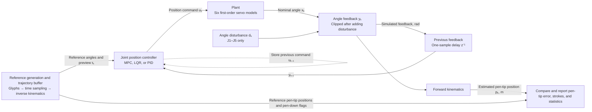
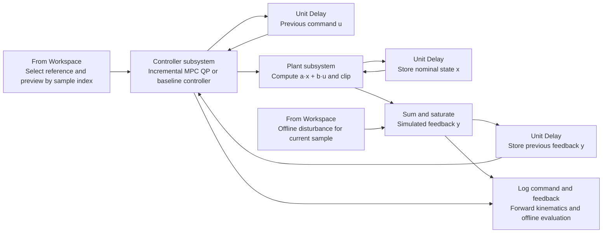

# EE528 Course Project Report

**Project title**　Closed-Loop Trajectory Tracking and Constrained Model Predictive Control for the NexArm Writing Robot  
**Name**　To be filled in  
**Student number**　To be filled in  
**Project option**　Option A · Optimal control. MPC is the primary controller, with LQR, PID, and direct reference commands as baselines.

This project uses a NexArm robot to write two lines of text on a horizontal surface and examines how servo lag and joint angle disturbances affect the resulting strokes. The system converts character shapes into joint angle references, uses joint feedback to compute each command, and reconstructs the pen-tip trajectory through forward kinematics. The Python implementation supports ROS 2/RViz and offline computation. The MATLAB implementation runs the numerical simulation and verifies the results independently. Both use the same 30 Hz reference trajectory and disturbances for comparison. In the numerical simulation, MPC reduced the pen-down 3D tracking RMS error from 10.4946 mm to 0.9006 mm and the XY contour RMS error from 3.1864 mm to 0.4872 mm. Sections 4.1 and 4.2 describe the status of physical hardware validation and the Simulink deliverable, respectively.

## 1. Project Background and Control Objective

### 1.1 Application and Problem

The robot writes `ee528` followed by `WU Dihang`. It lifts the pen to cross gaps between strokes and tracks a prescribed spatial trajectory while writing. When the planned angles are sent directly to the servos, the joints take time to reach the commanded positions. Differences in servo response can delay the pen tip and distort the stroke shape. Servo positioning errors can also introduce local jitter. Differences in joint response timing are particularly visible in the time-aligned pen-tip error near corners, pen contact transitions, and lifts.

The **control objective** is to reduce pen-tip tracking error during writing and contour error in the finished letters under the same reference, initial conditions, and disturbances. Commands must respect the angle and per-sample increment limits of each joint. MPC also places position and velocity limits on the predicted outputs. The direct-command baseline (`off`) sends the reference angles to the same motor model, which still introduces lag and disturbances. The project defines no absolute error threshold. Performance is evaluated by improvement over that baseline and by checking constraints under the same conditions.

### 1.2 Modeling Assumptions and Verification Scope

- **Kinematic chain.** J1–J5 determine the pose of the gripper and the rigidly mounted pen. J6 controls gripper opening and stays at a fixed holding angle while writing. The URDF defines the joint axes, zero-position geometry, and simulation limits.
- **Actuators.** The six servos are modeled as independent first-order position responses with a fixed sampling period of $T_s=1/30$ s. Simulated angle feedback for J1–J5 includes bounded, correlated disturbances. These model parameters are simulation settings. No hardware identification was used to estimate them.
- **Geometry.** The writing surface is horizontal, and the pen tip is located through a fixed mounting transform. The model omits interjoint dynamic coupling, compliance, friction, and paper contact forces. The planner marks pen-down samples, and the reported results retain any simulated pen-tip height error.
- **Verification scope.** RViz is used to inspect robot motion, coordinate frames, strokes, and ROS feedback topics. MATLAB is used for numerical reproduction, error measurement, and parameter sweeps. Physical hardware validation would examine actual servo behavior, calibration, and paper contact. Section 4.1.5 describes the evidence currently available.

### 1.3 Performance Metrics

Let $\mathcal I$ denote the set of pen-down sample indices, $\mathbf p_k^{\rm ref}$ the reference pen-tip position, and $\mathbf p_k$ the pen-tip position obtained by applying forward kinematics to the feedback joint angles. The positions are in meters. The time-aligned 3D pen-tip RMS error is

$$
E_{\mathrm{XYZ}}=1000\sqrt{\frac{1}{|\mathcal I|}
\sum_{k\in\mathcal I}\|\mathbf p_k-\mathbf p_k^{\rm ref}\|_2^2}
\quad[\mathrm{mm}].
$$

| Metric | Calculation and interpretation |
|---|---|
| XY tracking RMS (mm) | RMS planar position error at matching sample times. It still reflects timing lag. |
| XY contour RMS (mm) | Find the nearest point on the reference polyline of the same stroke for each simulated pen-down point, then compute the RMS distance. This measures shape error without requiring the pen to reach that point at the same time. |
| Joint RMS (°) | Compute the RMS difference between simulated feedback and reference angles across all pen-down samples and J1–J5. Convert the result from radians to degrees. |
| Transient response and control input | Inspect startup and local changes of direction, instantaneous pen-tip error over the full run, $u_{j,k}$, and $\Delta u_{j,k}/T_s$. Record the number of constrained MPC solves, fallback events, and computation time. |

For a simulated planar point $\mathbf p$ and a reference segment $\mathbf a\to\mathbf b$, the closest point on the segment is $\mathbf a+s(\mathbf b-\mathbf a)$, where $s=\operatorname{clip}((\mathbf p-\mathbf a)^{\mathsf T}(\mathbf b-\mathbf a)/\max(\|\mathbf b-\mathbf a\|_2^2,10^{-24}),0,1)$. The distance is minimized over the segments of the same stroke. See the Python and MATLAB implementations in [compare.py](../algorithm/mpc/compare.py) and [evaluate.m](../matlab/+nexarm/+metrics/evaluate.m).

## 2. Control Architecture and Controller Design

### 2.1 Closed-Loop Block Diagram and Signal Definitions



*Figure 1. Joint position feedback loop. Joint angle vectors are in radians. Forward kinematics supplies the pen-tip position used for evaluation.*

At sample $k$, the controller reads the previous angle feedback $\mathbf y_{k-1}$, the previous command $\mathbf u_{k-1}$, and the known reference angle $\mathbf r_k$. MPC also reads a preview of the reference. The controller then issues $\mathbf u_k$, after which the plant produces $\mathbf y_k$. The new disturbance $\mathbf d_k$ is therefore unavailable when the same sample's command is computed. The pen-tip position is calculated from $\mathbf y_k$, and the controller cost is defined in joint space. The simulation initializes the feedback, nominal motor state, and previous command to the first reference angles.

### 2.2 Rationale for Choosing MPC

The writing path is known in advance, so the controller can use future reference samples. MPC uses the model to anticipate the lag of different servos and handles command magnitudes, command rates, predicted angles, and predicted velocities in one optimization. The tradeoff is that a constrained QP may need to be solved at each sample, and compensation depends on how well the model matches the actuators. For the theory of receding-horizon control, see [Rawlings, Mayne, and Diehl's textbook](https://sites.engineering.ucsb.edu/~jbraw/mpc/index.html).

LQR computes fixed gains from the first-order model and provides a baseline for assessing the benefit of model-based feedback. PID provides a classical feedback baseline that uses the current error, accumulated error, and rate of error change. Each run uses one controller. See the six end-to-end program flowcharts in [image.md](../image.md).

## 3. Mathematical Modeling, Control Laws, and Code Correspondence

### 3.1 From Sampled Glyphs to Joint References

`text_strokes()` uses polylines, circular arcs, and cubic Bézier curves to define ordered strokes in dimensionless glyph coordinates $(u,v)$. For example, before rotation, the $i$th character in `ee528` uses $X=0.355+0.045v$ and $Y=0.085-0.036i-0.025u$ in meters, with $i$ starting at 0. The name is laid out using character widths and spacing, then its horizontal extent is mapped to the width of the first line. Each line is rotated by 180° about its own center so the text reads correctly from behind the base. Sampling the Bézier parameters, straight lines, and arcs establishes the stroke geometry before timing is assigned. See [glyph generation in draw_s.py](../nexarm_description/nexarm_description/draw_s.py#L46).

`writing_targets()` converts the planar strokes to 3D segments and inserts pen lifts, travel through the air, and lowering motions. The default writing height in `base_link` is $-0.10$ m, and the pen lift is $0.015$ m. The base is raised by $0.10$ m along the $Z$ axis of `world`, giving world heights of $0$ m with the pen down and $0.015$ m with the pen up. For segment $i$ with endpoints $\mathbf a_i,\mathbf b_i$, let $\ell_i=\|\mathbf b_i-\mathbf a_i\|_2$ be its length. The input parameter $T_{\rm plan}=50$ s allocates the sample budget.

$$
n_i=\max\!\left(3,\left\lceil\frac{30\,T_{\rm plan}\ell_i}{\sum_j\ell_j}\right\rceil\right),\qquad
\mathbf p_i(s)=\mathbf a_i+(3s^2-2s^3)(\mathbf b_i-\mathbf a_i),\qquad
s=\frac{1}{n_i},\ldots,1 .
$$

The smooth interpolation gives zero velocity at each segment endpoint. Rounding up and requiring at least three samples per segment increase the total sample count. The `ink[k]` flag indicates whether the segment from the previous point to the current sample should leave a stroke. Pen lifts and travel through the air still participate in the feedback loop and are excluded from the pen-down RMS calculation. See [time sampling in draw_s.py](../nexarm_description/nexarm_description/draw_s.py#L125).

Let $\mathbf q$ denote the joint angle vector in radians. Using the URDF, multiply each fixed joint-origin transform $\mathbf T_{0,i}$ and joint-axis rotation $\mathbf T_{{\rm rot},i}(q_i)$ in kinematic chain order. A fixed joint contributes only its origin transform. Given the gripper position $\mathbf p_g$ and rotation matrix $\mathbf R_g$, the pen tip is $0.04$ m forward and $0.125$ m below the gripper in its local frame.

$$
\mathbf T_g=\prod_i\mathbf T_{0,i}\mathbf T_{{\rm rot},i}(q_i),\qquad
\mathbf p_{\rm tip}(\mathbf q)=\mathbf p_g+
\mathbf R_g\begin{bmatrix}0.04\\0\\-0.125\end{bmatrix}.
$$

For a target $\mathbf p_k^*$, `plan()` solves the following bounded nonlinear least-squares problem at each sample. The coefficient $0.1$ weights the orientation residual and can be interpreted in m/rad.

$$
\mathbf f_k(\mathbf q)=
\begin{bmatrix}
\mathbf p_{\rm tip}(\mathbf q)-\mathbf p_k^*\\
0.1(q_2+q_3+q_4)
\end{bmatrix},
\qquad
\min_{\underline{\mathbf q}\le\mathbf q\le\overline{\mathbf q}}
\frac12\|\mathbf f_k(\mathbf q)\|_2^2 .
$$

The planner solves for J1–J4 only. It initializes the first point with `[0, 0.5, -0.4, 1.47]` rad, then warm-starts each solve from the previous result. The orientation term keeps the sum of the pitch angles near zero so the pen stays approximately vertical. The code rejects a point if the pen-tip position error exceeds $0.5$ mm or the weighted residual norm exceeds $0.0005$. It also checks whether adjacent joint angle differences multiplied by 30 exceed $3.14$ rad/s. The reference angles for J5 and J6 are then set to $0$ rad and $0.447817892$ rad, respectively. Applying forward kinematics to the solved joint angles gives the reachable pen-tip reference $\mathbf p_k^{\rm ref}$. J6 changes the gripper opening without changing the rigid chain that carries the pen. See the [planning code](../nexarm_description/nexarm_description/draw_s.py#L161) and [SciPy bounded least-squares documentation](https://docs.scipy.org/doc/scipy/reference/generated/scipy.optimize.least_squares.html).

### 3.2 Servo Response, Sampling, and Disturbances

Let $x_j(t)$ be the nominal angle of motor $j$, $u_j(t)$ its position command, and $\tau_j$ its time constant in seconds. The first-order model satisfies $\tau_j\dot x_j+x_j=u_j$. Solving this equation with the command held constant over one sample gives $x_j(t+T_s)=u_j+(x_j(t)-u_j)e^{-T_s/\tau_j}$. The resulting coefficients and discrete model before clipping are

$$
a_j=\begin{cases}e^{-T_s/\tau_j},&\tau_j>0,\\0,&\tau_j=0,\end{cases}
\quad b_j=1-a_j,\quad
\mathbf x_k=\mathbf A\mathbf x_{k-1}+\mathbf B\mathbf u_k,
\quad \mathbf A=\operatorname{diag}(a_j),\ \mathbf B=\mathbf I-\mathbf A .
$$

Here $\mathbf x_k,\mathbf u_k,\mathbf y_k,\mathbf r_k\in\mathbb R^6$ have units of radians. $\mathbf A,\mathbf B$ are dimensionless $6\times6$ matrices, and $\mathbf I$ is the identity matrix. The implementation clips the nominal state to the joint limits. It then generates a correlated disturbance using $\mathbf d_k=\rho\mathbf d_{k-1}+(1-\rho)\mathbf w_k$ and computes $\mathbf y_k=\operatorname{clip}(\mathbf x_k+\mathbf d_k,\underline{\mathbf q},\overline{\mathbf q})$. J1–J5 have independent innovations $w_{j,k}\sim\mathcal U(-\varepsilon,\varepsilon)$, and J6 has zero disturbance. The configuration uses $\rho=0.35$, $\varepsilon=0.2\pi/180$ rad, and the initial filter state $\mathbf d_{-1}=\mathbf 0$. $\operatorname{clip}$ acts separately on each joint. Positive $\tau$ governs how quickly a position approaches the command.

The lower and upper position limits are $\underline{\mathbf q}=[-2.09,-1.57,-3.14,-0.66,-2.09,0]^{\mathsf T}$ and $\overline{\mathbf q}=[2.09,1.4,0.3,1.57,2.09,0.5]^{\mathsf T}$, in radians. The URDF sets the maximum velocity of all six channels to $v_{j,\max}=3.14$ rad/s, which gives the per-sample increment limit $\delta_j=v_{j,\max}T_s\approx0.10467$ rad. These limits apply to the current simulation model. See the [Python motor simulation](../algorithm/mpc/nexarm_mpc/simulation.py), [MATLAB motor model](../matlab/+nexarm/+model/MotorModel.m), and [Xacro model](../nexarm_description/urdf/nexarm.urdf.xacro).

### 3.3 MPC Prediction Model, Objective, and Constraints

The model, cost, and constraints are separable by servo. The joint subscript $j$ is omitted below. At sample $k$, the nominal state $\hat x_{k-1}$ is propagated from previously issued commands and compared with measured feedback $y_{k-1}$ to estimate the disturbance residual $\hat d_{k-1}=y_{k-1}-\hat x_{k-1}$. Holding the previous command throughout the prediction horizon gives the free response at prediction step $i$.

$$
F_i=a^i\hat x_{k-1}+(1-a^i)u_{k-1}+\rho^i\hat d_{k-1},\qquad i=1,\ldots,N_p .
$$

Let $\mathbf z=[\Delta u_k,\ldots,\Delta u_{k+N_c-1}]^{\mathsf T}$ contain the $N_c$ command increments in radians, starting with $\Delta u_k=u_k-u_{k-1}$. Increment $j$ affects all future commands from step $j$ onward. Its contribution to the output at step $i$ is $1-a^{i-j+1}$. The resulting predictions are

$$
\mathbf U=\mathbf 1u_{k-1}+\mathbf L\mathbf z,\qquad
\mathbf Y=\mathbf F+\mathbf M\mathbf z,\qquad
L_{ij}=\mathbb 1_{i\ge j},\quad
M_{ij}=\begin{cases}1-a^{i-j+1},& i\ge j,\\0,&i<j.\end{cases}
$$

$\mathbf U,\mathbf Y,\mathbf F$ are $N_p$-dimensional column vectors, and $\mathbf L,\mathbf M\in\mathbb R^{N_p\times N_c}$. $\mathbf 1$ is a column vector of ones. Increments beyond the control horizon are zero. The reference window $\mathbf R_k$ starts at $r_k$. When fewer than $N_p$ references remain, the final reference angle fills the remaining entries. The objective weighs angle error with $\mathbf W=\operatorname{diag}(1,\ldots,1,2)$ and penalizes command increments. $\mathbf W$ and $\lambda=0.002$ specify relative numerical weights.

$$
\begin{aligned}
J(\mathbf z)&=(\mathbf Y-\mathbf R_k)^{\mathsf T}\mathbf W(\mathbf Y-\mathbf R_k)
+\lambda\,\mathbf z^{\mathsf T}\mathbf z,\\
\min_{\mathbf z}\ &\tfrac12\mathbf z^{\mathsf T}\mathbf H\mathbf z+\mathbf g^{\mathsf T}\mathbf z,
\qquad \mathbf H=2(\mathbf M^{\mathsf T}\mathbf W\mathbf M+\lambda\mathbf I),\quad
\mathbf g=2\mathbf M^{\mathsf T}\mathbf W(\mathbf F-\mathbf R_k).
\end{aligned}
$$

Expanding the square and dropping terms independent of $\mathbf z$ gives the quadratic program. The positive regularization weight $\lambda>0$ makes the Hessian positive definite. The following constraints apply separately to each joint.

| Constraint | Implementation |
|---|---|
| Command angle | $q_{\min}\le U_i\le q_{\max}$. |
| Command increment | $-\delta\le z_j\le \delta$. |
| Predicted output angle | $q_{\min}\le Y_i\le q_{\max}$. |
| Predicted output increment | $-\delta\le Y_1-y_{k-1}\le\delta$ for the first step, then $-\delta\le Y_i-Y_{i-1}\le\delta$. |

Let $\mathbf D$ be the difference matrix between consecutive samples, with the first row selecting the first output. The decision-dependent term in the output rate constraint is $\mathbf D\mathbf M$. The preceding measured angle $y_{k-1}$ is also subtracted from the first row of the free term. All four constraints can therefore be written as $\mathbf A_c\mathbf z\le\mathbf b_c$. The code first checks the unconstrained solution $\mathbf z_0=-\mathbf H^{-1}\mathbf g$. If it satisfies all constraints, the code uses it directly. Otherwise, it runs a constrained solver and checks the result. If that solve fails or the problem is infeasible, the controller clips $r_k-\hat d_{k-1}-u_{k-1}$ to the increment and position limits and records a fallback. The fallback bounds the issued command, while the predicted output constraints may still be infeasible. The controller applies only the first move and propagates its nominal state using the resulting command. It repeats the prediction using new feedback at the next sample.

The defaults are $N_p=12$ (0.40 s) and $N_c=8$ (approximately 0.267 s). The prediction horizon covers part of the servo response and previews upcoming turns, while the shorter control horizon reduces the number of variables per joint. The terminal weight of 2 emphasizes the end of the prediction window, and the increment weight trades off changes in the command against tracking accuracy. These settings form the baseline for the parameter sweep in Section 5.3. The predicted velocity limits apply to the model output. Disturbances that arrive after the command and discrepancies on physical hardware can still affect actual velocity. See the [Python MPC](../algorithm/mpc/nexarm_mpc/linear_incremental.py) and [MATLAB MPC](../matlab/algorithm/MPCController.m) implementations.

### 3.4 LQR and PID Baselines

**LQR.** For one servo and a fixed reference $r$, define the state deviation $\xi=x-r$ and the command deviation $\nu=u-r$, so $\xi^+=a\xi+b\nu$. To minimize $\sum_{n=0}^{\infty}(Q\xi_n^2+R\nu_n^2)$, take the value function $V(\xi)=P\xi^2$. Differentiating the one-step cost $\ell+V(\xi^+)$ with respect to $\nu$ gives $(R+b^2P)\nu+abP\xi=0$. Substitution gives

$$
P=Q+a^2P-\frac{(abP)^2}{R+b^2P},\qquad
K=\frac{bPa}{R+b^2P},\qquad
u_k^{\rm raw}=r_k-K(y_{k-1}-r_k).
$$

The defaults $Q=20,R=0.2$ are relative weights on angle error and command deviation. The ratio $Q/R=100$ assigns more weight to tracking error in this scalar design and can increase correction magnitudes. The output command is still clipped. At a fixed reference, with no disturbance and no active clipping, the error evolves with coefficient $a-bK$. Python uses `solve_discrete_are` to solve the scalar equation. MATLAB rearranges it as $b^2P^2+cP-QR=0$, where $c=R(1-a^2)-Qb^2$, and chooses an equivalent positive-root formula based on the sign of $c$ to reduce cancellation. Both cache $K$ when constructing the controller. See [Python LQR](../algorithm/lqr/nexarm_lqr/controller.py), [MATLAB LQR](../matlab/algorithm/LQRController.m), the [SciPy DARE documentation](https://docs.scipy.org/doc/scipy/reference/generated/scipy.linalg.solve_discrete_are.html), and the [MathWorks dlqr documentation](https://www.mathworks.com/help/control/ref/lti.dlqr.html).

**PID.** Compute the proportional error $e_k=r_k-y_{k-1}$ in radians, update the candidate integral $I_k^*=I_{k-1}+T_se_k$ in rad·s, and filter the discrete derivative $D_k=0.8D_{k-1}+0.2(e_k-e_{k-1})/T_s$ in rad/s. The derivative is zero at the first sample. The command combines reference feedforward and PID correction as $u_k^{\rm raw}=r_k+K_pe_k+K_iI_k^*+K_dD_k$. The defaults are $K_p=0.6$, $K_i=0.5\ \mathrm{s^{-1}}$, and $K_d=0.01\ \mathrm{s}$. The proportional term compensates for current error, the integral term addresses sustained error, and filtering with a small derivative gain reduces the amplification of angle disturbances by differentiation. If $(u_k^{\rm raw}-u_k)e_k>0$ after clipping, the controller keeps the previous integral so it does not drive the command further into saturation. This parameter set serves as the PID baseline. See [Python PID](../algorithm/pid/nexarm_pid/controller.py) and [MATLAB PID](../matlab/algorithm/PIDController.m).

Both LQR and PID clip the raw command to the intersection of the joint position and increment limits, giving $u_k=\operatorname{clip}(u_k^{\rm raw},\max(q_{\min},u_{k-1}-\delta),\min(q_{\max},u_{k-1}+\delta))$.

## 4. Project Implementation

Python and MATLAB provide separate implementations. Each language implements the controllers and sample-by-sample servo simulation, including initialization, feedback, and results. They share the exported URDF model data and fixed experiment inputs so the comparison uses the same trajectory. The MATLAB simulation runs independently from the exported files. To change the reference trajectory, regenerate those files with the Python glyph generator and bounded inverse kinematics planner.

### 4.1 Python Implementation and ROS 2/RViz Simulation

#### 4.1.1 File Structure and Module Responsibilities

| Function | Files and responsibilities |
|---|---|
| Trajectory, model, and ROS node | [draw_s.py](../nexarm_description/nexarm_description/draw_s.py) parses Xacro, generates the trajectory, runs forward and inverse kinematics, and publishes joint angles, strokes, and error. |
| Feedback loop | `JointTrackingSimulation` in [simulation.py](../algorithm/mpc/nexarm_mpc/simulation.py) constructs the selected controller, generates disturbances, caches state, and advances one sample at a time. |
| Controllers | [PID](../algorithm/pid/nexarm_pid/controller.py) updates error history, [LQR](../algorithm/lqr/nexarm_lqr/controller.py) computes and caches the gains, and [MPC](../algorithm/mpc/nexarm_mpc/linear_incremental.py) updates the nominal state and solves the QP. |
| Offline comparison | [compare.py](../algorithm/mpc/compare.py) runs each mode, computes pen-tip tracking error, contour error, and joint angle error, and writes the statistics to JSON. |
| Data export | The [CSV exporter](../nexarm_description/nexarm_description/export_trajectory.py) saves time and J1–J5 in degrees. The [MAT reference exporter](../matlab/tools/export_reference.py) saves the complete model, trajectory, pen-down flags, disturbances, and benchmark results. |

#### 4.1.2 Sample Loop and MPC Solver

The excerpt below shows the main operations in `JointTrackingSimulation.step()`. It omits the direct-command branch and assignments to the result arrays. The variable `index` corresponds to sample $k$. At the time of the controller call, `self.measured` and `self.previous_command` still hold values from the preceding sample. The motor updates the nominal angle before adding `self._errors[index]` for the current sample. Resetting the state and index enables repeatable playback with the same seed. See the [Python feedback loop](../algorithm/mpc/nexarm_mpc/simulation.py#L80).

```python
horizon = self.controller.horizon
indices = np.minimum(np.arange(index, index + horizon), len(self.reference) - 1)
command, _ = self.controller.command(
    self.measured, self.previous_command, self.reference[indices])
self.nominal = np.clip(self.a * self.nominal + (1 - self.a) * command,
                       self.lower, self.upper)
self.measured = np.clip(self.nominal + self._errors[index],
                        self.lower, self.upper)
```

Python MPC caches `L`, `D`, `M`, `G = D @ M`, `H`, and `H_inverse`. At runtime, it computes the gradient from `free` and tests the unconstrained solution from `-H_inverse @ gradient`. A constrained solve uses SciPy SLSQP with the analytic gradient `hessian @ v + g`, `Bounds` for command increments, and `LinearConstraint` for the joint predictions. The project sets `ftol=1e-10` and a maximum of 100 iterations. The code checks the result and constraints, and records solver calls and fallbacks. This implements the QP in Section 3.3. See the [Python MPC source](../algorithm/mpc/nexarm_mpc/linear_incremental.py) and [SciPy SLSQP documentation](https://docs.scipy.org/doc/scipy/reference/optimize.minimize-slsqp.html).

#### 4.1.3 Running the RViz Simulation and Inspecting Signals

Run these commands from the project root. Build the ROS 2 workspace before the first run. Replace `mpc_enabled:=true` with `pid_enabled:=true` or `lqr_enabled:=true` to use one of the baseline controllers. Enable one controller per run.

```bash
source /opt/ros/jazzy/setup.bash
colcon build --symlink-install --packages-up-to nexarm_description
source install/setup.bash
ros2 launch nexarm_description draw_s.launch.py mpc_enabled:=true
```

The launch file starts the robot model, drawing node, RViz, and playback panel. During initialization, RViz shows the robot and the reference characters. Click the button labeled **开始运行** (Start) to advance the simulation at 30 Hz. The node publishes simulated joint feedback to `/joint_states`, and `robot_state_publisher` updates the robot's TF transforms. The reference and simulated strokes are published to `/drawing_markers` in `base_link`, with `world` as the fixed frame in RViz. Adjacent points are connected only when `ink` is true. Gray lines show the reference, and the line color for the simulated strokes depends on the controller. The node publishes instantaneous error to `/writing/pen_error_mm` and cumulative pen-down RMS to `/writing/pen_rms_mm`. Replay clears the strokes and restarts from the same initial state, with repeatable disturbances for a fixed seed. See the [RViz launch file](../nexarm_description/launch/draw_s.launch.py) and [ROS node](../nexarm_description/nexarm_description/draw_s.py#L351).

RViz displays the robot pose, pen lifts, closed-loop error, and replay. The project also provides a Gazebo demonstration that uses Gazebo's position tracking. Its feedback is separate from that of the simulated servo loop described here. The Python values in Section 5 come from the offline benchmark. See the [repository simulation instructions](README.md).

#### 4.1.4 Trajectory Data Collection and Format Conversion

The offline exporter first computes reachable references as described in Section 3.1, then stores timestamps at $t_k=k/30$. The CSV stores time and J1–J5, with joint angles converted to degrees by $\frac{180}{\pi}q_{\rm rad}$. The MAT data retains radians and all six joint references, as well as pen-tip positions in meters, pen-down flags, the URDF-derived model, sample times, and benchmark disturbances. The older `trajectories/ee528.csv` file contains 1722 data points. The two-line MAT trajectory used here comes directly from the current planner and contains 2535 points, including 1835 pen-down samples across 18 continuous pen-down intervals. The two files represent different versions and contain different fields.

```bash
# With the ROS environment sourced, export joint angles from the current planner
ros2 run nexarm_description export_trajectory --output trajectories/ee528_current.csv

# From the project root, export the MATLAB reference and Python benchmark
python3 matlab/tools/export_reference.py
```

The exporter writes `reference.mat`, `python_baseline.mat`, and `metadata.json`. The benchmark stores commands, feedback, and pen-tip positions for each mode. The metadata records parameters and SHA-256 hashes of the relevant source files. If only the CSV is available, multiply its angles by $\pi/180$ to obtain radians and provide J6, pen-down flags, and calibration data separately. See the [MAT exporter](../matlab/tools/export_reference.py) and [current data version](../matlab/data/metadata.json).

#### 4.1.5 Physical Robot Integration and Hardware Validation

**Current status.** The repository provides the NexArm URDF/Xacro model, kinematic parameters, joint limits, and offline command references. The manual control panel publishes joint states to RViz. A physical servo driver is not connected to this code. The available material contains no hardware photos, writing videos, encoder logs, or externally measured pen-tip traces, so no physical tracking error or hardware closed-loop result can be reported. See the [manual control panel documentation](../UI/README.md).

Hardware integration requires a mapping into the joint coordinate system used by the controller. Let $c_j$ be the servo count on axis $j$, $c_{0,j}$ its zero-position count, $C_j$ the counts per revolution, $g_j$ the effective gear ratio, and $s_j\in\{-1,1\}$ the direction sign. If the device supports a linear count-to-angle model, the joint angle in radians is $\displaystyle q_j=s_j\frac{2\pi(c_j-c_{0,j})}{C_j g_j}$. Apply the inverse conversion to commands and quantize them according to the device interface. If the driver already returns joint angles, apply the calibrated unit and direction conversion directly. Verify zero positions, directions, scale factors, gripper travel, and operating limits axis by axis. Check the simulated limits separately against the physical range of motion.

After calibrating the base-to-paper transform and pen-tip offset, first keep the pen lifted to check trajectory reachability and motion directions. Then log timestamped commands and encoder readings for single-joint steps or low-speed moves. For a response close to first order, the time to reach approximately 63.2% of the total change estimates $\tau_j$. Check communication delay, steady-state error, and velocity limits separately. Feed the hardware readings to the existing control law in place of simulated `measured` feedback. No artificial random disturbance is added in hardware operation. Reconfigure the controller for the measured timing and verified limits before comparing direct-command and MPC handwriting.

| Hardware record | Purpose |
|---|---|
| Workstation photos, robot and paper arrangement, and calibration records | Document the relationship between the base, pen, and work surface frames. |
| Timestamps, joint references, issued commands, encoder feedback, and pen-down state | Calculate actual response times, joint errors, and command rates, and identify dropped samples. |
| Physical strokes with a known scale or a pen-tip tracking record | Paper traces can be used to compute static XY contour error. Independent time-aligned 3D error requires calibrated, synchronized external pen-tip measurements. Estimates from encoder readings and forward kinematics should be identified separately. |

### 4.2 Independent MATLAB Implementation, Numerical Simulation, and Simulink Plan

#### 4.2.1 File Structure, Parameters, and Initial Conditions

| Module | Files and responsibilities |
|---|---|
| Entry points | [run_simulation.m](../matlab/run_simulation.m) runs one mode. [compare_controllers.m](../matlab/compare_controllers.m) reuses the same reference and disturbances for four modes and summarizes the results. |
| Configuration and input | [default_config.m](../matlab/config/default_config.m) defines defaults. [loadReference.m](../matlab/+nexarm/+trajectory/loadReference.m) loads the model, reference, pen-down flags, and benchmark disturbances. |
| Controller classes | [PIDController.m](../matlab/algorithm/PIDController.m), [LQRController.m](../matlab/algorithm/LQRController.m), and [MPCController.m](../matlab/algorithm/MPCController.m) provide `command` and `reset`. |
| Discrete simulation and kinematics | [run.m](../matlab/+nexarm/+simulation/run.m), [MotorModel.m](../matlab/+nexarm/+model/MotorModel.m), and [forwardKinematics.m](../matlab/+nexarm/+model/forwardKinematics.m) implement the feedback loop and pen-tip calculation in MATLAB. |
| Metrics and verification | [evaluate.m](../matlab/+nexarm/+metrics/evaluate.m) calculates the metrics. [run_tests.m](../matlab/run_tests.m) tests the model, constraints, fallbacks, and sample-by-sample agreement with the Python benchmark. |

The fixed step is $1/30$ s. The run advances through all 2535 samples, with the final sample at approximately 84.4667 s. The six joint angles at the first reference sample initialize the preceding command, feedback, and nominal motor state. Time constants are $[0.6,0.5,0.6,0.4,0,0]$ s. The error bound is $0.2^\circ$, the random seed is 42, and the correlation coefficient is 0.35. With the default seed and correlation coefficient, MATLAB multiplies `noise_unit` by `error_deg`. Python generated and filtered `noise_unit` at a $1^\circ$ amplitude and stored it in radians. Other seeds use a private MATLAB random stream. The four-mode comparison uses one disturbance sequence throughout, and cross-language comparisons use the exported common sequence.

#### 4.2.2 MATLAB Control Computation and Toolbox Selection

The excerpt shows the controller branch of the main loop in `run.m`, omitting controller construction, the `off` branch, and result buffering. The variable `indices` fills the prediction window with the final sample when needed. The loop updates `measured` after issuing the command, preserving the same causal order as the Python implementation. See the [MATLAB simulation loop](../matlab/+nexarm/+simulation/run.m).

```matlab
for k = 1:n
    indices = min(k:k+controller.horizon-1, n);
    command = controller.command(measured, previous, reference(indices,:));
    measured = motor.step(command, errors(k,:));
    previous = command;
    tips(k,:) = nexarm.model.forwardKinematics(model, measured);
end
```

`MPCController.m` computes the unconstrained solution using `-(hessian\gradient)`. If that solution violates a constraint, it converts the lower and upper bounds into $\mathbf A_c\mathbf z\le\mathbf b_c$ and calls `solveQP.m`. The test installation had no `quadprog`, so the experiments used the included dual solver. The solver first normalizes the constraint rows. For row $i$, denoted $\mathbf a_i^{\mathsf T}$, it computes $d_i=\mathbf a_i^{\mathsf T}\mathbf H^{-1}\mathbf a_i$ and then cycles through the updates

$$
\mu_i^{+}=\max\!\left(0,\mu_i+
\frac{\mathbf a_i^{\mathsf T}\mathbf z-b_i}{d_i}\right),\qquad
\mathbf z^{+}=\mathbf z-\mathbf H^{-1}\mathbf a_i(\mu_i^{+}-\mu_i).
$$

The dual multiplier $\mu_i$ is nonnegative. Each update maintains $\mathbf H\mathbf z+\mathbf g+\mathbf A_c^{\mathsf T}\boldsymbol\mu=\mathbf 0$. The implementation also checks primal feasibility, the complementarity residual, and the change in the solution between sweeps. If the checks fail, the controller falls back to a bounded command. Installations with a licensed Optimization Toolbox can use `quadprog`. The results here use `dual`. LQR uses the scalar Riccati root from Section 3.4, and PID uses MATLAB array operations. Neither requires an additional toolbox. See the [MATLAB QP solver](../matlab/+nexarm/+internal/solveQP.m) and [Hildreth's original paper](https://onlinelibrary.wiley.com/doi/10.1002/nav.3800040113).

#### 4.2.3 Running the MATLAB Simulation and Reproducing Outputs

Run the following in the MATLAB Command Window. The default configuration generates a results table, MAT files, and trajectory plots. Set `animate=true` to play the 3D linkage animation with strokes. For batch runs, use `plot=false` if plots are unnecessary.

```matlab
cd('/home/maple/Desktop/EE528/matlab')
[summary, runs] = compare_controllers;
result = run_simulation('mpc', struct('animate', true));
run_tests
```

The comparison writes `matlab/results/comparison.mat`, `comparison.csv`, and `comparison.json`, and figures can be exported to PNG. The MAT file stores commands, feedback, pen-tip positions, and references for each sample and supplies the response and input plots in Section 5. The repository documents a previous run in MATLAB R2026a in which all 12 tests passed. They cover motor step response, PID anti-windup, LQR stability, active MPC constraints and fallback, causality, reset behavior, and sample-by-sample benchmark agreement. See the [MATLAB usage and verification notes](../matlab/README.md).

#### 4.2.4 Simulink Architecture and Deliverable Status

The repository contains runnable MATLAB scripts and classes. It does not contain an `.slx` or `.mdl` model. Figure 2 shows the **proposed Simulink architecture** in the order used by the sample loop. All numerical results in this report come from MATLAB scripts. The course deliverable still requires building and validating the native model and including a screenshot of it.



*Figure 2. Proposed discrete Simulink model. Inputs come from the MATLAB workspace. The blocks follow the signal flow of the current code.*

Use a fixed-step discrete solver at $1/30$ s and read one reference and disturbance sample per step. Initialize the three `Unit Delay` blocks with the first reference angles. They store the previous command, nominal plant state, and previous feedback, respectively. The controller subsystem maintains the MPC nominal state and cached prediction matrices. MATLAB can prepare the preview for each sample index and pass it to the subsystem, padding the end with the final reference. Log $\mathbf u_k,\mathbf y_k$ at every step and evaluate them with the same `ink` flags, forward kinematics, and error functions to compare the results with the MATLAB script sample by sample. See [MathWorks Unit Delay documentation](https://www.mathworks.com/help/simulink/slref/unitdelay.html).

## 5. Results, Analysis, and Conclusions

### 5.1 Default Conditions and Cross-Language Comparison

All four runs use the same two-line reference, initial state, and disturbance sequence. Section 4.2.1 gives the defaults. The Python 3D RMS values in Table 1 were recomputed from the 1835 pen-down samples in `python_baseline.mat`. The MATLAB values come from `compare_controllers`. Tracking and contour metrics in this table use pen-down samples only.

| Mode | Python 3D tracking RMS (mm) | MATLAB 3D tracking RMS (mm) | MATLAB XY tracking RMS (mm) | MATLAB XY contour RMS (mm) | MATLAB joint RMS (°) |
|---|---:|---:|---:|---:|---:|
| Direct reference commands | 10.49459 | 10.49459 | 9.98980 | 3.18636 | 1.68958 |
| PID | 8.73375 | 8.73375 | 8.34624 | 1.96379 | 1.30433 |
| LQR | 1.72664 | 1.72664 | 1.59826 | 0.51444 | 0.22383 |
| **MPC** | **0.90057** | **0.90058** | **0.71549** | **0.48716** | **0.08202** |

*Table 1. Tracking performance under the defaults of 30 Hz, seed 42, and an error bound of ±0.2°. See the original Python results in [python_baseline.mat](../matlab/data/python_baseline.mat).*

In MATLAB, MPC reduced 3D tracking RMS by **91.4%** and XY contour RMS by **84.7%** relative to direct commands. LQR achieved a contour error close to MPC's under these conditions, while its time-aligned 3D error was about 1.92 times that of MPC. Controller selection therefore depends on whether the final shape or time-aligned tracking matters more. The default MPC run triggered 453 constrained QP solves across all joints and recorded zero fallbacks. The 99th-percentile controller computation time in this run was approximately 0.99 ms, below the 33.33 ms simulation period. This measures control computation only. Hardware communication, plotting, and scheduling overhead need separate measurement.

The Python and MATLAB implementations agree to floating-point precision sample by sample for the direct-command, PID, and LQR modes. For MPC, the largest difference in an individual pen-tip coordinate between MATLAB and the default Python SLSQP benchmark was approximately **0.0108 mm**. The `mpc_tight` comparison reduces the Python SLSQP tolerance to $10^{-14}$. The maximum coordinate difference falls to approximately $9.43\times10^{-8}$ m. With the model, reference, and disturbances held fixed, the result is consistent with numerical solver tolerance explaining the default discrepancy. See the [MATLAB regression tests](../matlab/tests/test_controllers.m) and [benchmark generator](../matlab/tools/export_reference.py).

### 5.2 Trajectories, Transient Response, and Control Inputs


*Figure 3. MATLAB simulation responses. The left panel projects the pen-down trajectory onto the base-frame $Y$–$-X$ axes in millimeters. The right panel shows time-aligned 3D pen-tip error over the entire run, including pen-up motion.*

Figure 3 shows visible lag and distortion with direct commands. PID reduces some of the error, and LQR and MPC stay closer to the reference. The peak 3D errors for the four modes, in Table 1 order, were approximately 40.77, 28.85, 5.61, and 2.89 mm, at approximately 41.50, 44.10, 19.27, and 49.37 s, respectively. These peaks include pen-up samples, while Table 1 uses pen-down samples. Because the reference keeps moving, local time windows are used to examine transients instead of assigning a single step-response settling time to the whole run.


*Figure 4. MATLAB joint J2 response and control input. Panel (a) shows the simulated angle, (b) the command applied to the model, (c) the first 8 s in detail, and (d) the difference between adjacent commands divided by the sampling period. Dashed lines mark the reference or simulated rate limits.*

The J2 time constant is 0.5 s. During the first 8 s, the maximum J2 deviation was approximately $2.65^\circ$ with direct commands, $2.12^\circ$ with PID, $0.63^\circ$ with LQR, and $0.14^\circ$ with MPC. Figure 4(b) shows how the command differs from the reference angle. LQR compensates for lag using the difference between the current reference and previous feedback. MPC can also use the reference preview to adjust the command before a turn. Across the full run, the largest absolute MPC command rate for J2 was 1.88 rad/s, below that joint's simulation limit of 3.14 rad/s. Figure 4(d) shows the command rate for J2 only. The per-sample MPC solve and feasibility checks determine whether the other joint constraints and predicted output velocity limits are satisfied.

### 5.3 Parameter Sweep

The MATLAB sweep holds $N_c=8$, the initial state, and the disturbances fixed. Each variation changes either the prediction horizon $N_p$ or the increment weight $\lambda$. Command-increment RMS in Table 2 is computed across all samples and all six joints, including the difference between the initialized command and the first issued command. None of the four runs recorded a fallback.

| $N_p$ (samples) | $\lambda$ | 3D tracking RMS (mm) | XY contour RMS (mm) | Command increment RMS (rad/sample) | Constrained QP solves |
|---:|---:|---:|---:|---:|---:|
| 8 | 0.002 | 0.90171 | 0.48791 | 0.011467 | 52 |
| **12** | **0.002** | **0.90058** | **0.48716** | **0.011477** | **453** |
| 18 | 0.002 | 0.90420 | 0.48672 | 0.011505 | 1557 |
| 12 | 0.020 | 0.93512 | 0.49757 | 0.009222 | 52 |

*Table 2. One-factor parameter sweep using the included MATLAB QP solver.*

Increasing the horizon from 8 to 12 samples slightly reduced 3D error and increased the number of constrained solves. At 18 samples, 3D tracking error increased, and XY contour error improved slightly. With the horizon held at 12 samples, raising $\lambda$ by a factor of ten reduced command-increment RMS by about 19.6% and increased 3D error by about 3.8%. The default 12/8 horizons gave the lowest 3D error in this sweep. The eight-sample prediction horizon and the higher increment weight provide measured alternatives when fewer constrained solves or smoother commands take priority. The trajectory and seed were fixed, so small differences should be checked under other conditions.

The following MATLAB commands reproduce Table 2. Run them from the project's `matlab/` directory.

```matlab
setup
data = nexarm.trajectory.loadReference();
cfg = default_config();
cfg.mode = 'mpc';
cfg.solver = 'dual';
cases = [8 .002; 12 .002; 18 .002; 12 .020];
for i = 1:size(cases, 1)
    cfg.horizon = cases(i, 1);
    cfg.increment_weight = cases(i, 2);
    result = nexarm.simulation.run(data, cfg);
    du = diff([data.reference(1,:); result.commands], 1, 1);
    fprintf('%d %.3g %.5f %.5f %.6f %d %d\n', ...
        cfg.horizon, cfg.increment_weight, ...
        result.metrics.pen_xyz_rms_mm, result.metrics.pen_xy_contour_rms_mm, ...
        sqrt(mean(du.^2, 'all')), result.statistics.active_qps, ...
        result.statistics.fallbacks);
end
```

### 5.4 Conclusions, Limitations, and Contributions

For the independent first-order servo model, two-line trajectory, fixed parameters, and bounded disturbances used here, MPC met the relative objective of reducing tracking and contour errors. It achieved a pen-tip 3D RMS error of approximately 0.901 mm and completed all samples without solver fallback under the default conditions. Python/RViz displays the robot pose and strokes. MATLAB independently reproduces the numerical results and provides the comparison plots and parameter sweep.

The main limitations are that motor time constants and disturbance behavior have yet to be identified from the physical robot, and evaluation estimates the pen-tip position from joint feedback and forward kinematics. Friction, backlash, paper contact, communication delay, and physical limits can change the outcome. The MPC constraints act on predicted model behavior. Hardware limits still need independent verification. The current evidence supports the simulation results. Hardware performance and sample-by-sample verification of a native Simulink model remain outstanding.

**Project implementation.** The work covers two-line stroke generation and sampling with pen lifts, URDF-to-pen-tip kinematics, separate Python and MATLAB feedback loops, incremental MPC predictions and constraints, MAT benchmark export, error evaluation, and the comparison experiments in this report. The project uses the existing NexArm Xacro model and meshes. Record their source and version from the project records. SciPy solvers, ROS 2/RViz, MATLAB, and the cited control theory are external foundations. Before submission, complete the name and student number and confirm which work was completed personally, which assets were reused, and where tools assisted the work.

The structure follows the five components in the supplied *EE528 Course Project Instructions*. The instructions specify submission of the PDF report, MATLAB scripts or functions, and Simulink model via Canvas by the **end of the final class on 27 November 2026**. This is the English Markdown version. The figures are in `images/` alongside this report. The separate program flowcharts and further details on trajectory fields and controller implementations are available in [image.md](../image.md) and [report.md](../../report.md).
