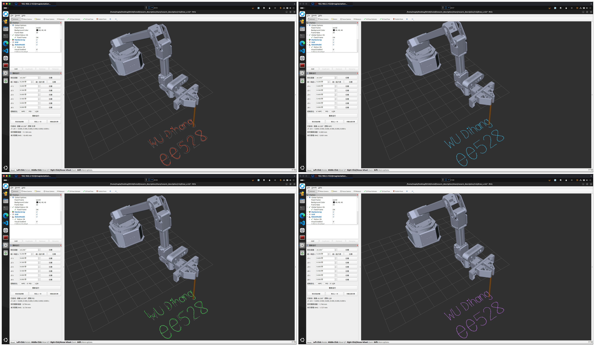
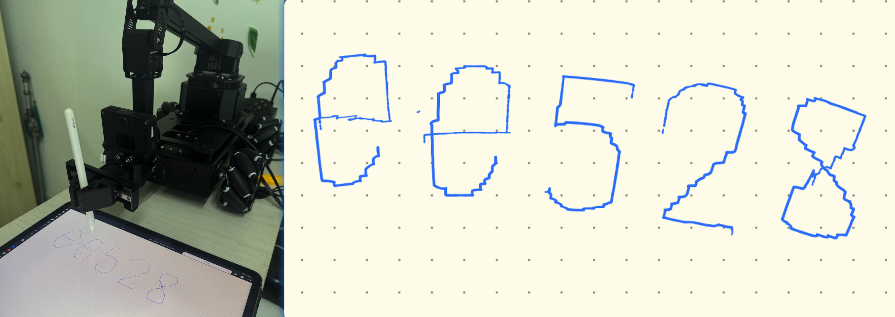
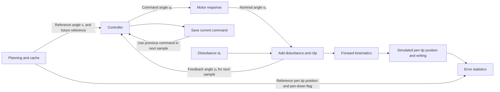
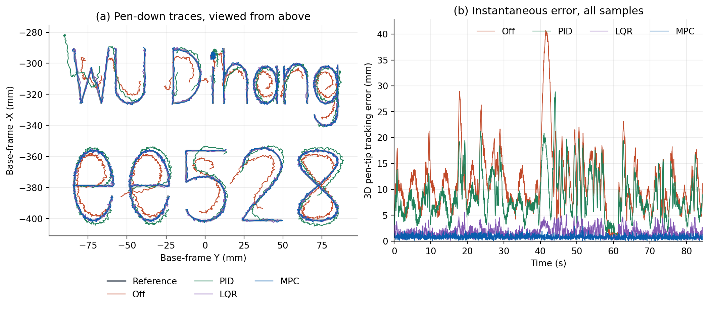

## Closed-loop Tracking and Optimization of Robot Arm Writing Trajectory

Name WU Dihang · Student ID 26040407g

Course topic A: Optimal Control

Project Github Address: `https://github.com/DihangWU/EE528`

* When the robot arm writes, the servo motors of different joints respond to commands at different speeds. The pen tip will fall behind, and the shape is also easy to change at corners.

* This project uses ros2 and rviz. By manually setting different response delays for the joints and random servo accuracy errors, it simulates the running situation of a real robot arm. MPC, LQR and PID are used separately for trajectory optimization. Together with the mode without optimization (Off mode), totally four modes are compared and evaluated.
    
    
    *Figure 1　Four optimization modes: top left without optimization (off), top right MPC, bottom left PID, bottom right LQR*
    
* The simulated robot arm in this project is completely the same as the real physical robot arm, and the real arm was also used to finish the writing. But because the servo accuracy is limited, there is no meaning to do optimization. So only the mode without optimization was used with iPad and Apple Pencil to verify the correctness of the writing `ee528`.
  
  
  *Figure 2　Writing result of the real robot arm*
  
  

## 1. Project Goal and Overall Plan

### 1.1 Writing Task and Control Problem

The robot arm holds a pen and writes the course code `ee528` and the name `WU Dihang` on a horizontal plane. Even if the given strokes are completely correct, the motors still need time to turn to the target angles. For example, when writing the bottom of `2`, the pen tip should change from a diagonal line to a horizontal line. If several joints follow at different speeds, this corner will become deformed. The project compares four ways of sending commands, to see which one can make the pen tip arrive at the target on time and keep the letter shape as much as possible.

The four modes are directly sending the reference angles (Off), Proportional–Integral–Derivative (PID), Linear Quadratic Regulator (LQR) and Model Predictive Control (MPC). Only one mode is selected for each run. During comparison, the trajectory, starting point and disturbances are fixed. We check how much the error is reduced compared with Off, and whether the commands meet the joint angle and speed limits. The project evaluates the effect by relative improvement, without setting a required error value in millimeters beforehand.

### 1.2 System Input, Output and Closed-loop Block Diagram

**During planning**, the program calculates the angle that each joint should turn to, point by point along the strokes, so the pen tip can reach the planned position. This planned angle is called the **reference angle**, also called the **target angle**.

**During simulation**, Off mode directly sends the reference angles to the motor model as commands. PID, LQR and MPC use the current sample's reference angles and the previous sample's feedback angles to calculate commands. MPC also looks at the following reference angles in advance. After receiving the command, the motor model calculates the angles reached by each joint in this sample. These are the new **feedback angles**. The program then calculates the pen tip position from these feedback angles, connects the pen-down points of each stroke in order, and gets the simulated writing for comparison with the reference strokes.

| Symbol | Meaning in this report |
|---|---|
| $j$, $k$, $T_s$ | $j$ is the joint number. J1–J6 mean joints 1–6 (J comes from Joint). $k$ is the sample index, and $k-1$ is the previous sample. $T_s$ is the time between two samples, and the subscript $s$ means sampling. |
| $r_{j,k}$, $u_{j,k}$ | The reference angle and the actually sent command angle of joint $j$ at sample $k$. |
| $x_{j,k}$, $d_{j,k}$, $y_{j,k}$ | The nominal angle calculated by the motor model, the disturbance added to this angle, and the simulated feedback angle returned to the controller after clipping. |

*Figure 3　System input, output and closed-loop diagram*

### 1.3 Different Work of Python／ROS 2／RViz, MATLAB and Real Robot Arm

Python generates the reference trajectory and calculates the control commands and motor response. ROS 2 transfers joint angles and writing data; RViz shows the robot arm movement; MATLAB runs the four modes independently with the same input, making it convenient to draw figures and check the numbers; the real robot arm is used for writing without optimization, to check whether the planned joint movements can drive the pen to finish the strokes.

The model fixes the pen on the gripper and uses the positions of J1–J5 to calculate the pen tip coordinates. J6 only controls the gripper opening and closing. The six servos respond separately, and the time constants are simulation settings. The paper is set as a horizontal plane, and the pen-down state comes from the planning. Even if the pen tip calculated from feedback is slightly above or below the paper, the program still keeps this height error. The dynamic effects between joints, structural elasticity, friction and pen contact force are not considered.

## 2. Generation of Reference Writing Trajectory

### 2.1 Letter Shape Definition of ee528 and WU Dihang

The planner first divides `ee528` and `WU Dihang` into ordered strokes. Straight strokes use line segments, and curved strokes use circular arcs or cubic Bezier curves. For example, `e` starts from the middle horizontal line and then goes around an open loop; the curved parts of `2` and `5` are connected by Bezier curves. The start and end points decide the two ends of the curve, and the other two control points decide the bending direction. `8` uses one continuous curve to finish the upper and lower loops, keeping the pen down when passing the middle crossing point. The letter shape definition is in `text_strokes()` of `nexarm_description/nexarm_description/draw_s.py`.

### 2.2 Coordinate Mapping, Pen-down and Pen-up Planning

`writing_targets()` arranges the plane strokes into three-dimensional motion segments. The pen tip writes along the $X$ and $Y$ directions of the base coordinate frame, and lifts along the $Z$ direction. The name row is arranged according to letter widths and spacing, then scaled to the same width as `ee528`. Each row is rotated 180° around its own center, so the text direction is correct when looking from behind the base.

The writing plane is 0.10 m below the origin of the base coordinate frame `base_link`, corresponding to the ground of the world coordinate frame `world`. When changing strokes, the pen tip first lifts vertically by 15 mm, then moves horizontally to the next stroke's starting point and lowers down. Each segment has a pen-down flag, so the movement in air is included in the robot arm motion, but two strokes will not be connected together.

### 2.3 Time Sampling and Inverse Kinematics

The program arranges pen tip positions at 30 Hz (30 times per second). Longer line segments get more sampling points, with at least 3 points for each segment, and smooth starting and stopping at both ends. The default 50 s is used to allocate sampling points. After adding the minimum point count of each segment and rounding up, the whole trajectory actually takes about 84.47 s.

After knowing where the pen tip should go in one sample, the next step is to calculate how much each joint should turn. This is **inverse kinematics**. Let $k$ be the sample index and $\mathbf p_k^*$ be the target pen tip coordinates of that sample. The star means the target value. $\mathbf q=(q_1,q_2,q_3,q_4)$ are the angles of J1–J4 to be solved. The pen tip is fixed 0.04 m forward and 0.125 m downward in the gripper's local coordinates. From the link geometry and this fixed offset, the program calculates the pen tip coordinates $\mathbf p_{\rm tip}(\mathbf q)$ from $\mathbf q$ (tip means pen tip). Within the allowed joint angle ranges, it chooses $\mathbf q$ that makes the following expression smallest:

$$
\left\|\mathbf p_{\rm tip}(\mathbf q)-\mathbf p_k^*\right\|_2^2
+\left[0.1(q_2+q_3+q_4)\right]^2 .
$$

The first term is the squared straight-line distance from the pen tip to the target, and $\|\cdot\|_2$ means the vector length. The second term makes the sum of the three pitch angles close to zero, keeping the pen approximately vertical; 0.1 (m/rad) is the weight of the orientation term. When solving the next point, the previous sample's angles are used as the initial guess. `plan()` checks both the pen tip position error and the total residual including the orientation term. Both need to be within 0.5 mm. The joint speed needed between neighboring points also cannot exceed 3.14 rad/s (radians per second). The reference angle of J5 is fixed at zero, and J6 keeps the pen-holding angle. Finally, the solved angles are put back into forward kinematics to get the reachable reference pen tip position.

### 2.4 Sharing the Reference Trajectory Between Two Platforms

When ROS 2 starts, it calls the Python planner to generate the reference trajectory. MATLAB reads `matlab/data/reference.mat`, which is exported in advance by the same planner. It stores the reference angles of six joints, reference pen tip coordinates, sampling times and pen-down flags. So the results from both sides can be compared at the same time and on the same stroke. The default two-row trajectory has **2,535 sampling points**, including **1,835 pen-down points**, belonging to **18 continuous pen-down sections**.

After changing the letter shape, lifting height or writing duration, `matlab/tools/export_reference.py` needs to be used to export the data again. This script also generates `matlab/data/python_baseline.mat`, for the test program to check the results calculated separately by MATLAB and Python. The sampling parameters and source file versions of the data are recorded in `matlab/data/metadata.json`. The `trajectories/ee528.csv` in the repository is an earlier trajectory with 1,722 points. This two-row experiment uses `reference.mat` as the reference.

## 3. Plant Modeling and Controller Design

### 3.1 First-order Motor Response Model and Random Disturbance

Consider one joint. Let $t$ be continuous time, $u$ be the command angle kept constant within one sample, $x(t)$ be the nominal angle, and $\tau$ (the Greek letter tau) be the motor time constant in s. The first-order model assumes that the turning speed is proportional to the remaining angle difference. Let $t_0$ be the starting time of this sample, then

$$
\frac{dx}{dt}=\frac{u-x}{\tau}
\quad\Longrightarrow\quad
x(t_0+T_s)-u=[x(t_0)-u]\exp(-T_s/\tau).
$$

$dx/dt$ means the rate of angle change with time, and $\exp$ is the natural exponential function. The right expression shows that after each sample, the remaining angle difference is multiplied by the same ratio. Let $a=\exp(-T_s/\tau)$ be the remaining ratio and $b=1-a$ be the ratio made up. Then the update equation used by the code in each sample is obtained (before clipping)

$$
x_k=a x_{k-1}+b u_k .
$$

The $\tau$ of J1–J4 are 0.6, 0.5, 0.6 and 0.4 s respectively. For example, J2 makes up $1-\exp[-(1/30)/0.5]\approx6.45\%$ of the remaining angle difference in each sample. If there is still 10° left, it turns about 0.645° in this sample. J5 and J6 are set to respond instantly, directly using $a=0$ and $b=1$.

To simulate the arrival error, let $w_k$ be the newly drawn random angle of this sample, uniformly distributed within ±0.2°. Let $\rho=0.35$ be the remaining ratio of the previous sample's disturbance, then $d_k=\rho d_{k-1}+(1-\rho)w_k$. The initial disturbance of each joint is zero. J1–J5 are sampled independently, and J6 keeps zero disturbance. The program first clips the nominal angle into the joint range, then clips $x_k+d_k$ into the same range as the feedback angle $y_k$.

By arranging the angles of six joints into a column vector in J1–J6 order, the update equations of all six motors can be written together. The diagonal of $\mathbf A$ contains the six $a_j$, and the diagonal of $\mathbf B$ contains the six $b_j=1-a_j$. All other elements are zero. Both matrices are $6\times6$. Let $\underline{\mathbf q}$ and $\overline{\mathbf q}$ be the lower and upper limits of the six joints. $\operatorname{clip}$ means cutting an out-of-range value to the nearest boundary. The actual update is

$$
\begin{aligned}
\mathbf x_k&=\operatorname{clip}(\mathbf A\mathbf x_{k-1}+\mathbf B\mathbf u_k,
                                 \underline{\mathbf q},\overline{\mathbf q}),\\
\mathbf y_k&=\operatorname{clip}(\mathbf x_k+\mathbf d_k,
                                 \underline{\mathbf q},\overline{\mathbf q}).
\end{aligned}
$$

Here, the bold symbols $\mathbf x_k,\mathbf u_k,\mathbf d_k,\mathbf y_k$ put the six nominal angles, command angles, disturbances and feedback angles together respectively. The table below lists the angle ranges used by the model. Xacro (XML Macros) uses macros to organize robot model files. XML (Extensible Markup Language) uses tags to describe data. The Xacro model is expanded into URDF at runtime. Robot arm model (`nexarm_description/urdf/nexarm.urdf.xacro`) · Python motor model (`algorithm/mpc/nexarm_mpc/simulation.py`) · MATLAB motor model (`matlab/+nexarm/+model/MotorModel.m`)

| Angle limit (rad) | J1 | J2 | J3 | J4 | J5 | J6 |
|---|---:|---:|---:|---:|---:|---:|
| Lower limit | −2.09 | −1.57 | −3.14 | −0.66 | −2.09 | 0 |
| Upper limit | 2.09 | 1.40 | 0.30 | 1.57 | 2.09 | 0.50 |

### 3.2 Closed-loop Feedback Timing and Joint Constraints

At sample $k$, the controller can use the target $r_k$, previous feedback $y_{k-1}$ and previous command $u_{k-1}$. Only after it sends $u_k$ does the motor produce the current feedback $y_k$. Let $\Delta$ mean the difference between two neighboring samples, $q_{\min},q_{\max}$ be the joint's lower and upper angle limits, and $v_{\max}$ be the speed limit (min and max mean minimum and maximum). The maximum allowed command change per sample $\delta$ is converted from the speed.

$$
\Delta u_k=u_k-u_{k-1},\qquad \delta=v_{\max}T_s,\qquad
q_{\min}\le u_k\le q_{\max},\quad |\Delta u_k|\le\delta .
$$

The vertical bars mean absolute value. This project uses $v_{\max}=3.14$ rad/s (radians per second), so $\delta\approx0.1047$ rad, about 6°. The proportional–integral–derivative controller and linear quadratic regulator below both clip the commands according to these two limits. Model predictive control also checks future joint angles and speeds in the prediction.

### 3.3 Off: Directly Sending Reference Commands

Off is the mode with the outer compensation turned off. The control law is only $u_k=r_k$, meaning the reference angle is sent as it is. Even if feedback shows the joint is behind, the next sample still sends the original target. Motor lag and disturbance still take effect normally, giving the baseline for the four groups of comparison.

### 3.4 PID Control

PID comes from Proportional, Integral and Derivative. First calculate the angle difference that needs correction now, $e_k=r_k-y_{k-1}$. Multiply the error by the sampling time and accumulate it to get the candidate integral $I_k^*$ (the star here means a candidate value). Divide the difference between neighboring errors by the sampling time to get the rate of change, then smooth it as below to get the derivative term $D_k$.

$$
I_k^*=I_{k-1}+T_s e_k,\qquad
D_k=0.8D_{k-1}+0.2\,\frac{e_k-e_{k-1}}{T_s}.
$$

$I_{k-1}$ is the accumulated error accepted in the previous sample (rad·s), and $D_{k-1}$ is the smoothed rate of change in the previous sample (rad/s). The derivative term of the first sample is set to zero. Starting from the target angle, add the three corrections to get the command before clipping, $u_k^{\rm raw}$ (raw means the original value).

$$
u_k^{\rm raw}=r_k+K_p e_k+K_i I_k^*+K_d D_k .
$$

$K_p=0.6$ is the proportional gain, deciding how much to correct at present. $K_i=0.5$ s⁻¹ is the integral gain, compensating the continuously accumulated error. $K_d=0.01$ s is the derivative gain, responding to the error change. The program clips the raw command into $u_k$. If the command has already reached the upper limit but the error still asks to increase it, the old integral is kept, to avoid accumulating more and more. The lower limit is handled in the same way.

The code uses $(u_k^{\rm raw}-u_k)e_k>0$ to judge whether the integral will push the command further towards the boundary. If the condition is true, it keeps $I_{k-1}$; otherwise it saves the candidate integral $I_k^*$. PID and LQR both check the joint travel range and the single-step change at the same time. Taking the intersection of the two limits, the actual allowed command range is

$$
\max(q_{\min},u_{k-1}-\delta)\ \le u_k\le\
\min(q_{\max},u_{k-1}+\delta).
$$

If $u_k^{\rm raw}$ is outside the range, the nearest boundary value is sent. Python PID implementation (`algorithm/pid/nexarm_pid/controller.py`) · MATLAB PID implementation (`matlab/algorithm/PIDController.m`)

### 3.5 LQR Control

LQR (Linear Quadratic Regulator) uses the motor model to calculate the correction coefficient for each joint. First consider the case where the target angle is fixed at $r$. Let $\xi=x-r$ be the nominal angle error and $\nu=u-r$ be the command compensation relative to the target. Since $a+b=1$, putting both into the update equation in 3.1 gives the next sample's error $\xi^+=a\xi+b\nu$, where the superscript $+$ means the next sample.

Give separate weights to the squared angle error and squared compensation, and the single-step cost is $Q\xi^2+R\nu^2$. $Q=20$ is the tracking error weight and $R=0.2$ is the control compensation weight. If the minimum long-term cost starting from the current error is written as $P\xi^2$, then $P$ is the coefficient describing the future cost. “Current sample cost plus the minimum cost of the next sample” should satisfy

$$
P\xi^2=\min_{\nu}\left[Q\xi^2+R\nu^2+P(a\xi+b\nu)^2\right].
$$

$\min_{\nu}$ means choosing the compensation that makes the value inside the brackets smallest. Taking the derivative with respect to $\nu$ and setting it to zero gives $(R+b^2P)\nu+abP\xi=0$. So the optimal compensation is $\nu=-K\xi$, where $K$ is the feedback gain. Putting the optimal compensation back into the above equation and rearranging it can determine both $P$ and $K$.

$$
P=Q+a^2P-\frac{(abP)^2}{R+b^2P},\qquad
K=\frac{abP}{R+b^2P}.
$$

The program calculates $K$ for each joint before starting the writing. During running, it uses the current target $r_k$ and available feedback $y_{k-1}$, and sends $u_k^{\rm raw}=r_k+K(r_k-y_{k-1})$ after clipping. In this way, for the same 1° lag, joints with different response speeds can get different compensation.

The above design adds up the cost of every future sample, meaning to find the minimum of $\sum_{n=0}^{\infty}(Q\xi_n^2+R\nu_n^2)$. Here $n$ is the number of samples counted from now, $\sum$ means summation, and $\infty$ means considering an infinitely long future time. The default weight ratio is $Q/R=100$, putting more attention on tracking accuracy. When the target is fixed, there is no disturbance and the command does not hit the limits, each sample's error becomes $a-bK$ times the previous one.

Python calls `solve_discrete_are` to solve the Discrete Algebraic Riccati Equation (DARE). MATLAB rearranges the same equation into $b^2P^2+cP-QR=0$, where $c=R(1-a^2)-Qb^2$ is the coefficient of the linear term. According to whether $c$ is positive or negative, the program chooses a more numerically stable form to find the positive root, avoiding precision loss from subtracting two very close numbers. Both sides only need to calculate the gain once, and use it directly during running. Python LQR implementation (`algorithm/lqr/nexarm_lqr/controller.py`) · MATLAB LQR implementation (`matlab/algorithm/LQRController.m`)

### 3.6 MPC: Prediction Model, Objective Function, Constraints and Receding-horizon Solution

MPC (Model Predictive Control) can see in advance where the stroke will turn. In each sample, it uses the motor model to predict where different commands will move the joint, then finds a set of commands that can follow the reference and meet the joint limits. The six servos are independent in the model, so only one joint is derived below. By default, it predicts $N_p=12$ samples ahead (0.40 s), where $p$ means prediction. It only adjusts the commands of the first $N_c=8$ samples (about 0.267 s), where $c$ means control. The last four samples keep the eighth sample's command, so each joint only needs to solve eight numbers each time.

**First calculate the angles when keeping the old command.** The controller uses previously sent commands to estimate the nominal angle $\hat x_{k-1}$, where the hat means an estimated value. Subtracting this nominal angle from the previous feedback angle gives the disturbance estimate $\hat d_{k-1}=y_{k-1}-\hat x_{k-1}$. If $u_{k-1}$ continues to be sent, according to the first-order model in Section 3.1, after $i$ samples the difference between the starting angle and this command has $a^i$ of its original value left, and the expected effect of the existing disturbance has $\rho^i$ left. This gives the predicted angle $F_i$ when keeping the old command.

$$
F_i=a^i\hat x_{k-1}+(1-a^i)u_{k-1}+\rho^i\hat d_{k-1},
\qquad i=1,\ldots,N_p .
$$

**Then calculate the effect of each command change.** Let $z_h=\Delta u_{k+h-1}$ be the command angle increase planned at step $h$, with $h=1,\ldots,N_c$. For example, after adding $z_1$ in the first step, this part of the command keeps taking effect. The joint turns an extra $(1-a)z_1$ in the first step, and the accumulated extra turn is $(1-a^2)z_1$ in the second step. So the angle change at step $i$ caused by the increment at step $h$ is $(1-a^{i-h+1})z_h$, provided that $h\le i$. Writing all increments as a column vector $\mathbf z=(z_1,\ldots,z_{N_c})^{\mathsf T}$ allows the whole command sequence and predicted angles to be calculated together. The superscript $\mathsf T$ means transpose, changing a row into a column or a column into a row.

$$
\begin{aligned}
\mathbf U &= \mathbf 1u_{k-1}+\mathbf L\mathbf z, &
L_{ih}&=\begin{cases}1,&h\le i,\\0,&h>i,\end{cases}\\
\mathbf Y &= \mathbf F+\mathbf M\mathbf z, &
M_{ih}&=\begin{cases}1-a^{\,i-h+1},&h\le i,\\0,&h>i.\end{cases}
\end{aligned}
$$

$\mathbf U$, $\mathbf Y$ and $\mathbf F$ each have $N_p$ elements, storing the planned command angles, predicted feedback angles and predicted angles when keeping the old command respectively, all in rad. $\mathbf 1$ is a column vector containing $N_p$ ones. $\mathbf L$ is used to accumulate command increments, and $\mathbf M$ represents how the increments affect the angles of each step after the motor lag. Both matrices have $N_p$ rows and $N_c$ columns, and the subscript $ih$ means row $i$, column $h$.

**Choose a solution that follows the strokes and sends smooth commands.** Arrange the $N_p$ reference angles starting from the current sample into a column vector $\mathbf r_{\rm win}$, where the subscript win means the prediction window. The $i$th reference corresponds to $r_{k+i-1}$. When the motion is near the end and there are not enough reference points, the last reference angle is used to fill the rest. The total cost $J$ consists of two squared costs: predicted angle error and command change.

$$
J(\mathbf z)=
(\mathbf Y-\mathbf r_{\rm win})^{\mathsf T}
\mathbf W(\mathbf Y-\mathbf r_{\rm win})
+\lambda\,\mathbf z^{\mathsf T}\mathbf z .
$$

$\mathbf W$ is the error weight matrix, with nonzero values only on the diagonal. The first 11 steps have weight 1 and the last step has weight 2, meaning more attention is put on the error at the end of the window. $\lambda=0.002$ is the command increment weight. Increasing it makes fast command changes more costly. Putting $\mathbf Y=\mathbf F+\mathbf M\mathbf z$ into the above equation, expanding the square and removing the constant unrelated to $\mathbf z$ gives the form used by the solver.

$$
\min_{\mathbf z}\;\tfrac12\mathbf z^{\mathsf T}\mathbf H\mathbf z+
\mathbf g^{\mathsf T}\mathbf z,\qquad
\mathbf H=2(\mathbf M^{\mathsf T}\mathbf W\mathbf M+\lambda\mathbf I),
\qquad
\mathbf g=2\mathbf M^{\mathsf T}\mathbf W(\mathbf F-\mathbf r_{\rm win}).
$$

Here $\min_{\mathbf z}$ means choosing the increment vector that makes the cost smallest. $\mathbf H$ is the quadratic coefficient matrix, describing the curvature of the cost surface. $\mathbf g$ is the linear coefficient vector, and $\mathbf I$ is the identity matrix of order $N_c$. Since $\lambda>0$, $\mathbf H$ is positive definite, and the optimal solution is unique when a feasible solution exists. The objective is a quadratic function and the limits below are all linear. This kind of problem is called Quadratic Programming (QP).

| Quantity to check for each joint | Constraint | Meaning |
|---|---|---|
| Planned command angle | $q_{\min}\le U_i\le q_{\max}$ | Every command stays within the joint travel range. |
| Command increment | $-\delta\le z_h\le\delta$ | The jump between two neighboring commands is limited. |
| Predicted feedback angle | $q_{\min}\le Y_i\le q_{\max}$ | The expected joint position also stays within the travel range. |
| Predicted angle change | $-\delta\le Y_i-Y_{i-1}\le\delta$, where $Y_0=y_{k-1}$ | The first sample is speed-limited relative to the known feedback, and later samples relative to the previous prediction. |

Here $\delta=v_{\max}T_s$ is the maximum angle change per sample converted from the speed limit in Section 3.2. The code uses the difference matrix $\mathbf D$ to calculate neighboring differences of $\mathbf Y$. Its first row takes $Y_1$ and then subtracts $y_{k-1}$, while the other rows calculate $Y_i-Y_{i-1}$. So the coefficient multiplying $\mathbf z$ in the speed constraints is $\mathbf D\mathbf M$. Putting the upper and lower bounds of the four types of conditions together gives $\mathbf A_c\mathbf z\le\mathbf b_c$, where $\mathbf A_c$ is the constraint coefficient matrix and $\mathbf b_c$ contains the upper bound of each row. The subscript $c$ here means constraint. These speed limits check the model predictions. New disturbance appearing after the command is sent may still change the feedback angular speed.

**Only execute the first step in this sample.** The program first sets the derivative of the cost with respect to $\mathbf z$ to zero, meaning solving $\mathbf H\mathbf z_0=-\mathbf g$, to get the candidate solution $\mathbf z_0$ without considering constraints for now. If it meets all constraints, it is used directly. Otherwise, a constrained solver is called and the result is checked again. If the problem is infeasible or solving fails, the controller takes $r_k-\hat d_{k-1}-u_{k-1}$ as the backup increment, first clips it by $\pm\delta$, then by the joint position limits, and records one fallback. During fallback, the sent command can be guaranteed to meet the angle and rate limits, but the predicted output may go outside the limits. Whichever solution is used, only $u_k=u_{k-1}+z_1$ is sent in this sample. The nominal state is updated using the actually sent command, and prediction is done again after receiving new feedback in the next sample. This is the “receding-horizon solution”. Python MPC implementation (`algorithm/mpc/nexarm_mpc/linear_incremental.py`) · MATLAB MPC implementation (`matlab/algorithm/MPCController.m`)

## 4. Result Evaluation

### 4.1 Experiment Conditions and Evaluation Metrics

The four modes start from the same initial pose, using the same two-row trajectory and the same set of arrival disturbances. The sampling frequency is 30 Hz, the disturbance amplitude limit is ±0.2°, and the random seed is 42. The tracking accuracy in the result table only counts the 1,835 pen-down samples out of 2,535 samples. RMS (Root Mean Square) means first squaring each error, taking the average and then taking the square root. So an occasional larger error will also be reflected in the result.

**1. Three-dimensional and Two-dimensional RMS: ** Let $\mathcal I$ be the set of all pen-down sample indices, and $N=1835$ be the number of points in it. $\varepsilon_{X,k},\varepsilon_{Y,k},\varepsilon_{Z,k}$ are the coordinate differences in the three directions after subtracting the reference pen tip from the simulated pen tip at sample $k$, in m. The three-dimensional distance of each sample is given by the Pythagorean theorem. Summarize these distances by RMS and multiply by 1000 to convert into mm, giving the three-dimensional tracking error $E_{XYZ}$. Keeping only the two components in the paper plane gives the plane tracking error $E_{XY}$.
$$
\begin{aligned}
E_{XYZ}&=1000\sqrt{\frac{1}{N}\sum_{k\in\mathcal I}
  (\varepsilon_{X,k}^{2}+\varepsilon_{Y,k}^{2}+\varepsilon_{Z,k}^{2})},\\
E_{XY}&=1000\sqrt{\frac{1}{N}\sum_{k\in\mathcal I}
  (\varepsilon_{X,k}^{2}+\varepsilon_{Y,k}^{2})}.
\end{aligned}
$$

**2. XY Contour RMS:** For each pen-down point, the nearest point is searched only on the reference polyline of the same stroke. If the pen tip moves slower along the correct straight line, the plane tracking error will become larger, but its distance to the reference line may still be close to zero.

For the actual calculation, let $\mathbf p$ be the projection of the simulated pen tip on the paper, $\mathbf a,\mathbf b$ be the starting and ending points of a reference line segment, and $\mathbf v=\mathbf b-\mathbf a$ be the segment direction. Project $\mathbf p-\mathbf a$ onto $\mathbf v$ to get the fraction $s$ along the segment and the nearest point $\mathbf p_{\rm near}$.

$$
s=\operatorname{clip}\!\left(
\frac{(\mathbf p-\mathbf a)\cdot\mathbf v}
     {\max(\|\mathbf v\|_2^2,10^{-24})},0,1\right),\qquad
\mathbf p_{\rm near}=\mathbf a+s\mathbf v.
$$

The subscript near means the nearest point. The dot means the vector dot product. $\operatorname{clip}$ limits the fraction between 0 and 1 so that the nearest point stays on the segment. The small value in the denominator is used to handle coincident endpoints. Take the shortest distance over all segments of the same stroke and call it $\ell_k$ (m). The contour error is $E_{\rm contour}=1000\sqrt{\sum_{k\in\mathcal I}\ell_k^2/N}$, in mm.

**3. Joint Angle RMS:** Subtract the reference angles $r_{j,k}$ from the feedback angles $y_{j,k}$ of J1–J5, getting $5N$ angle differences in total. The joint error $E_{\rm joint}$ takes the RMS of these angle differences, then uses $180/\pi$ to convert rad into degrees.
$$
E_{\rm joint}=\frac{180}{\pi}\sqrt{\frac{1}{5N}
 \sum_{k\in\mathcal I}\sum_{j=1}^{5}(y_{j,k}-r_{j,k})^2}.
$$

For the above four metrics, smaller is better. To find which times the errors mainly happen, we also need to look at the instantaneous error of the whole motion including pen lifts, especially at starting and turning parts. Python metric calculation (`algorithm/mpc/compare.py`) · MATLAB metric calculation (`matlab/+nexarm/+metrics/evaluate.m`)

### 4.2 Comparison of Writing and Tracking Errors in Four Modes

| Mode | Python 3D tracking RMS (mm) | MATLAB 3D tracking RMS (mm) | MATLAB XY tracking RMS (mm) | MATLAB XY contour RMS (mm) | MATLAB joint RMS (°) |
|---|---:|---:|---:|---:|---:|
| Off | 10.49459 | 10.49459 | 9.98980 | 3.18636 | 1.68958 |
| PID | 8.73375 | 8.73375 | 8.34624 | 1.96379 | 1.30433 |
| LQR | 1.72664 | 1.72664 | 1.59826 | 0.51444 | 0.22383 |
| **MPC** | **0.90057** | **0.90058** | **0.71549** | **0.48716** | **0.08202** |

*Table 1　Pen-down errors under the default condition. The Python column is recalculated from the saved pen tip positions of each sample, and the MATLAB columns come from the four-mode simulation.* Python baseline data (`matlab/data/python_baseline.mat`) · MATLAB comparison entry (`matlab/compare_controllers.m`)

*Figure 4　The left figure is the top view of the writing. The horizontal axis is the base Y axis, and the vertical axis is the opposite direction of the X axis, in mm. The gray line is the reference writing (Reference), and the colored lines are the simulated writing of the four modes. 3D (three-dimensional) in the right figure means the three-dimensional pen tip error (including pen lifts).*

Looking at the left figure, the Off writing deviates from the gray line at corners. PID corrects part of it, and LQR and MPC are closer to the reference. Compared with Off, MPC reduces the three-dimensional tracking RMS by **91.4%** and the XY contour RMS by **84.7%**. The contour error of LQR and MPC only differs by 0.027 mm, but the three-dimensional tracking error of LQR is about 1.92 times that of MPC.

In the right figure, the maximum instantaneous errors of Off, PID, LQR and MPC are 40.77, 28.85, 5.61 and 2.89 mm respectively, occurring at about 41.50, 44.10, 19.27 and 49.37 s. The target keeps moving, so these local peaks can better show at which part the pen tip cannot follow, compared with using one single “how long it takes to settle down”.

### 4.3 Project Conclusion, Limitations and Improvement Direction

This project has completed the two-row stroke planning with pen lifts and lowering, conversion from robot description to pen tip coordinates, two control loops in Python and MATLAB, MPC prediction and constrained solving, reference data and baseline export, as well as four-mode comparison and parameter tuning experiments. The NexArm Xacro model and meshes come from the robot arm manufacturer.

Under the given experiment conditions, the pen-down three-dimensional error of MPC is **0.901 mm** and the contour error is **0.487 mm**, both lower than the other three groups. The final letter shape of LQR is already close to MPC. Their bigger difference is whether the pen tip can arrive on time. For this model, knowing the next stroke in advance and sending commands earlier within the limits does help to compensate the motor lag.

The model treats the six servos separately as first-order responses, and the time constants and disturbances come from simulation settings. Joint coupling, structural elasticity, friction, backlash, pen–paper contact, communication delay and actual travel range of the real robot arm will all affect the writing, but this project did not further study these factors.
